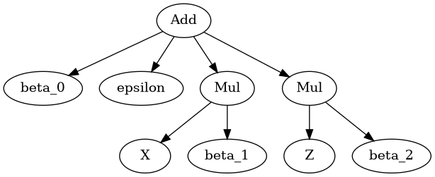
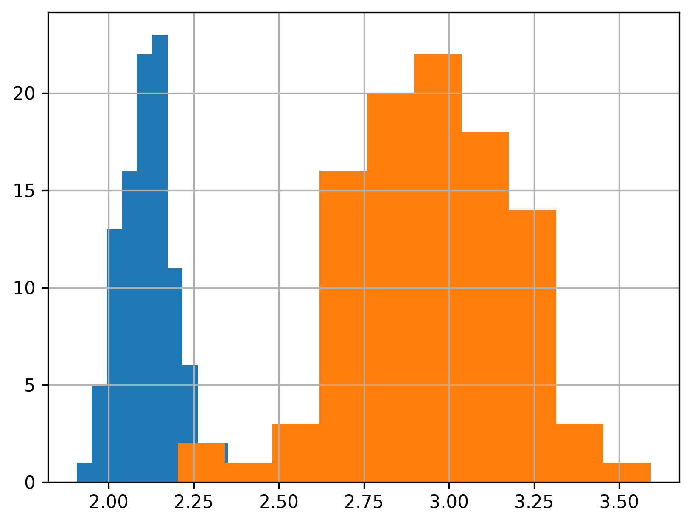
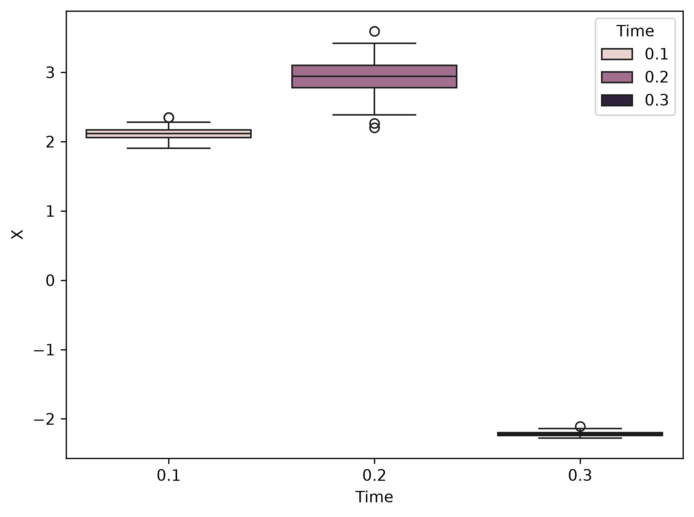
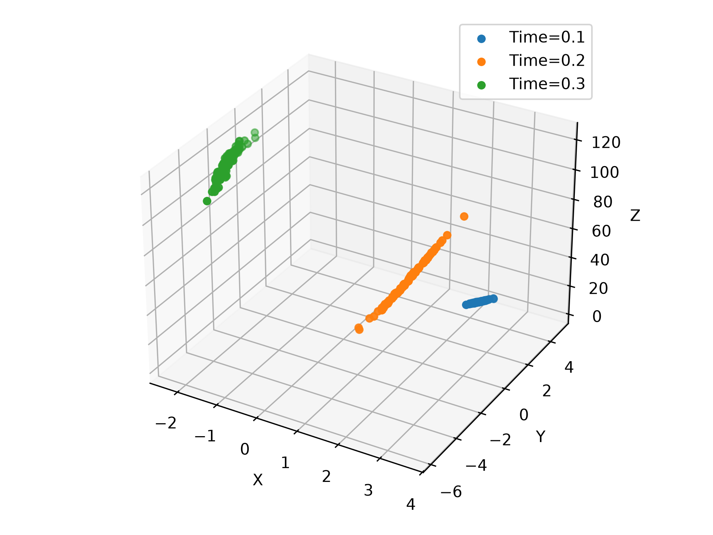
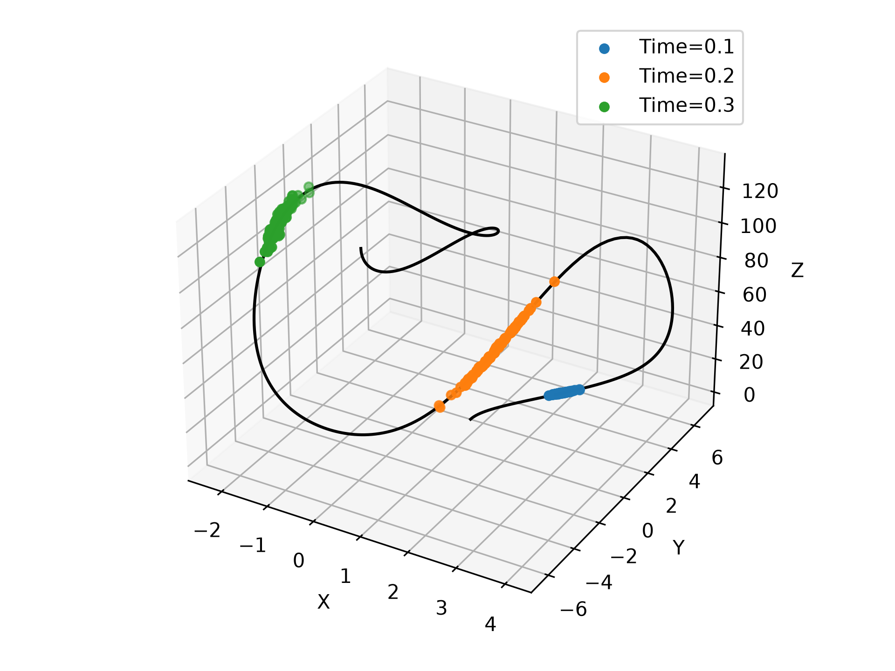

# Introduction

This post is about comparing and contrasting my view of what a statistical model is with how Dustin Fife views statistical models. One of the keystones of Dustin's perspective is that we should actually model the data rather than transformations of the data.

A [keystone](https://en.wikipedia.org/wiki/Keystone_(architecture)) is a term from architecture for a force-balancing stone at the top of an archway. Without it, the archway would collapse.

::: {#fig-keystone}


A similar notion is that of a [keystone species](https://en.wikipedia.org/wiki/Keystone_species) in community ecology.
:::


I want to challenge this keystone in this post, and suggest a different keystone. That is, I want to explain why I find the phrase "actually modelling the data" eventually unhelpful in my thinking, and how other ways of thinking can take its place. I think that Dustin's intuition about "*actually modelling the data*" helps him and his students avoid certain mistakes, so it is beneficial, but it also needlessly limits what you can do.

Let us jump straight to the crux of the matter: what are models?

# What are Models?

Dustin has made some claims about modelling. I've embedded videos where he describes models, and put quotes below them that are relevant. Watch the videos if you have time, otherwise these quotes are a sampling of his opinions.

::: {#fig-video-are-modern-robust-methods-useless}
<iframe width="560" height="315" src="https://www.youtube.com/embed/guJ0wTxiky4?si=LC_FR2HW7mvHKP3n" title="YouTube video player" frameborder="0" allow="accelerometer; autoplay; clipboard-write; encrypted-media; gyroscope; picture-in-picture; web-share" referrerpolicy="strict-origin-when-cross-origin" allowfullscreen></iframe>
:::

> **Quotation** (Dustin Fife)
>
> If you're a modeler, robustifying taints your data and the "model" you fit isn't really a model anymore, because it's trying to fit data that do not represent reality.

There are "robustifying" procedures, and some of them will make the modelling more difficult to interpret than a unrobustified counterpart. However, to extent that the data represents reality in some way, it is still the case that we're modelling something about reality through the data. For example, using a Huber loss term in an objective function to improve the resulting fit of a model is not necessarily turning the model into something that doesn't represent some aspect of reality; even though the Huber loss may have an effect on parametrization that is difficult to interpret.

> **Quotation** (Dustin Fife)
>
> So if you are a model[er] your primary concern is to find a model that accurately represents your data.

> **Quotation** (Dustin Fife)
>
> A model is a simplification of reality, and it retains the essential features [and] it ignores the non-essentials. I'm borrowing that definition from Joe Rogers.

::: {#fig-video-the-foundation-of-all-statistics}
<iframe width="560" height="315" src="https://www.youtube.com/embed/t2URzeyrDx4?si=CRc_QOQ6DS_l3JcZ" title="YouTube video player" frameborder="0" allow="accelerometer; autoplay; clipboard-write; encrypted-media; gyroscope; picture-in-picture; web-share" referrerpolicy="strict-origin-when-cross-origin" allowfullscreen></iframe>
:::

> **Quotation** (Dustin Fife)
>
> A model is a representation of reality. Its going to retain the "essential features" of reality while ignoring the non-essentials.

And I myself have echoed a similar sentiment in a comment on one of his videos:

> **Quotation** (Galen Seilis)
>
> I generally agree that modelling the data is preferable as it demonstrates a more complete understanding of the data generating process, but I don't think it is always practical.

Unfortunately, Galen today disagrees with Galen from over a year ago. Reading and contemplation will do that. Later in this post I will try to recover some likely points of agreement, but let us understand the disagreement about models first.

Without getting *too deep* into quagmires of epistemology and ontology, there is a basic philosophical problem: *representation* is too ubiquitous for our purposes here. If you're using any kind of language or symbols to represent things at all, and using this representation notion of a model, then you are modelling things. Taken to even a cursory logical rigor we find that anything that references the data can be thought of as *modelling the data*.

There is a metaphor I find helpful around this: the [map-territory relation](https://en.wikipedia.org/wiki/Map%E2%80%93territory_relation) [@korzybski1933]. I was going to explain it here, but I think these blog posts adequately cover the idea:

- [The Map is Not the Territory](https://www.lesswrong.com/tag/the-map-is-not-the-territory) on the *LessWrong* blog.
- [The Map is Not the Territory](https://fs.blog/map-and-territory/) on the *fs* blog.

Because anything that represents the data in some way can be claimed to be a model of it, it is a criterion that adds little to the considerations that we make in theoretical or applied statistics. Since rank-based statistics refer to the data via random variables, they are models of the data in this representation sense. We might model more or less of something, but whether we are modelling at all is a very low bar to meet.

It may be tempting to lean on the distinction that a model only represents the *essential* properties of something, but I don't find that helpful either. [Essentialism](https://en.wikipedia.org/wiki/Essentialism) looks at **all** the attributes necessary to specify the identity, but that is not what we're doing when we model. If I simulate a compartmental model of COVID-19 I am not keeping track of every [quantum number](https://en.wikipedia.org/wiki/Quantum_number) of every particle in the system. And yet such quantum numbers are part of our best models based on something frameworks like [quantum mechanics](https://en.wikipedia.org/wiki/Quantum_mechanics) or [quantum field theory](https://en.wikipedia.org/wiki/Quantum_field_theory). When I think I am modelling something, I don't think everything real is in it. Rather, my model itself is a part of everything that is real. Even if we go for essentialism, we will get stuck in the myriad traps in ontology. While I enjoy thinking about ontology, I don't think it is a productive direction for deciding whether to use certain statistical procedures. If you'd like an entertaining crash course in ontology, this edutainment video by VSauce is a whirlwind summary.

::: {#fig-video-do-chairs-exist}
<iframe width="560" height="315" src="https://www.youtube.com/embed/fXW-QjBsruE?si=1jQj4MSwgoEabYfO" title="YouTube video player" frameborder="0" allow="accelerometer; autoplay; clipboard-write; encrypted-media; gyroscope; picture-in-picture; web-share" referrerpolicy="strict-origin-when-cross-origin" allowfullscreen></iframe>
:::

I don't think that Dustin is referring to essentialism. He has mentioned separating the *signal* from *noise*, which is a different distinction from essentialism. But it also isn't clear to me how this distinction makes rank-based statistics into non-models.

While this "model as representation" is my preferred choice of meaning for "model" in my philosophical thinking, it is too broad for the binary classification Dustin would like to draw between rank-based statistics and non-rank-based statistics.

Let us move on to what I think about as a "statistical model".

# A General Statistical Model

One of the lexical barriers that exists between Dustin and I pertains to what we call a "model". Vaguely, a model is anything that we use to represent another thing. In particular we are interested in "statistical models" in this context. This motivated me to think on what I would call a model, and most especially near the edge cases where it is harder to decide if something is a model or not.

The most fundamental example I can think of in statistics is the notion of a random variable on a probability space. [Random variables](https://en.wikipedia.org/wiki/Random_variable) are [measurable functions](https://en.wikipedia.org/wiki/Measurable_function) of the [outcome space](https://en.wikipedia.org/wiki/Sample_space) of a [probability space](https://en.wikipedia.org/wiki/Probability_space) [@kolmogorov1933], and are perhaps the most common and elementary statistical models that we use to represent data with. A random variable $X$ has some probability distribution $F_X$ associated with it.

Simply declaring a random variable to represent a variable in our data set is usually only the beginning of what we can consider. Often we calculate functions of random variables, called "statistics". Functions of random variables are themselves random variables. So given a function $g$ and a random variable $X$ it holds that $g(X)$ is also a random variable. This still holds for compositions of functions. If I have a sequence of functions $g_1, \cdots, g_k$ and a random variable $X$, then $(g_k \circ g_{k-1} \circ \cdots g_2 \circ g_1) (X)$ is also a random variable. All random variables are statistical models if they are intended to represent something.

> This view is not restricted to random scalars. We could likewise think about random vectors, random matrices, random tensors, random graphs, random hypergraphs, random simplicial complexes, ..., random "things". The requirements of a random variable do not even include numbers, nor do mathematical functions have to even consider numbers. There is a lot more generality than some, perhaps Dustin or perhaps not, may realize.
{: .prompt-tip}

In contrast to using random variables (as formally or as informally as required), I am unsure what Dustin means by a "model". From watching many of his videos I believe he considers [general linear models](https://en.wikipedia.org/wiki/General_linear_model), [generalized linear models](https://en.wikipedia.org/wiki/Generalized_linear_model), [(linear) effects models](https://en.wikipedia.org/wiki/Mixed_model), and [structural equation models](https://en.wikipedia.org/wiki/Structural_equation_modeling), and at least some (unspecified) [nonlinear regression](https://en.wikipedia.org/wiki/Nonlinear_regression) models to be models. I suspect further combinations thereof such as [generalized linear mixed models](https://en.wikipedia.org/wiki/Generalized_linear_mixed_model) and [nonlinear mixed effects models](https://en.wikipedia.org/wiki/Nonlinear_mixed-effects_model) probably qualify as well. Attempting an empirical induction (which may suffer from the [problem of induction](https://en.wikipedia.org/wiki/Problem_of_induction) [@hume1748]), I infer that any [regression analysis](https://en.wikipedia.org/wiki/Regression_analysis) has sufficient conditions for being a model in Dustin's view, but I will leave that speculation for Dustin to correct. I agree that these are all models, but what remains is unclear to me is whether we agree on that conclusion for the same reasons.

There are a couple of things I like about this 'general statistical model' I have suggested.

The first thing is that it allows for careful reasoning. I can state various assumptions about functions and distributions and derive or compute the consequences of the assumptions. This doesn't make the reasoning easy to carry out, but it does provide a framework for carefully doing so.

The second thing is that it is a highly general theoretical framework. Whenever I encounter a new statistical problem I very often find that it falls within this framework of thinking. (The exceptions are interesting, weird, and beyond the scope of this post.) Recipes that can be useful mental shortcuts if they are prepared carefully and used in an appropriate context, but often they fall short. I was taught such recipes early in my education, and they are not what has stuck with me because of the problem described in the following quote:

> **Quotation** (as cited in @sundberg1994)
>
>	Most real-life statistical problems have one or more nonstandard features. There are no routine statistical questions, only questionable statistical routines.
>  > This quote is attributed to J.M. Hammersley in a footnote of Sundberg 1994 [@sundberg1994]. It is also attributed to D.R. Cox [here](https://stats.stackexchange.com/a/737/69508).
> {: .prompt-info}

To emphasize again, I don't think statistical recipes like flow charts are *useless*. Rather they are just part of a wider arsenal of ways of thinking and solving problems. I appreciate the attitude expressed by Richard McElreath in his *Statistical Rethinking* course material [@mcelreath2020]. He expresses his view in the first few minutes of the following video, although I will provide a quote below as well.

::: {#fig-video-statistical-rethinking-2023-golem-of-prague}
<iframe width="560" height="315" src="https://www.youtube.com/embed/cclUd_HoRlo?si=Ct0xmuYFEHnnGcsQ" title="YouTube video player" frameborder="0" allow="accelerometer; autoplay; clipboard-write; encrypted-media; gyroscope; picture-in-picture; web-share" referrerpolicy="strict-origin-when-cross-origin" allowfullscreen></iframe>
:::

> **Quotation** (Richard McElreath)
>
> In introductory statistics courses what you do is consult a flow chart. Pick a procedure which gives you a p-value. The purpose of all of the procedures that populate a chart like this are to test the null hypothesis; to reject the null hypothesis (hopefully). The research hypothesis itself, the target of your scientific investigation, is anonymous in these charts. And this has led to a lot of dissatisfaction when you move on to do more fundamental research in your field because the procedures in these introductory courses don't really address fundamental causation in any satisfying way. And they're highly inflexible compared to the very large domain of hypotheses that scientists consider at the cutting edge of their fields.

Richard in this quote is considering things from a fundamental science point of view, as I think he should. An example of this is his emphasis on causation because he wants to teach scientists how to incorporate causal reasoning into their statistical analysis. There are applications of statistics that are purely predictive which actually benefit from using non-causal statistical dependence. Even null hypothesis testing has utility in certain control systems, but (1) they tend not to align with research hypotheses and (2) require 'nice' assumptions that often do not hold for partially understood complex systems like people or ecosystems.

This problem of (sometimes mindlessly) sticking to recipes is not limited to classic null hypothesis tests. We should not limit ourselves to particular regression procedures such as general(ized) linear models either.

If you've never seen statistical analysis outside general linear models, Richard McElreath provides some introductory examples which I think are instructive:

::: {#fig-video-statistical-rethinking-2023-generalized-linear-madness}
<iframe width="560" height="315" src="https://www.youtube.com/embed/Doaod09YitA?si=aAGohPJU1NLY3FwM" title="YouTube video player" frameborder="0" allow="accelerometer; autoplay; clipboard-write; encrypted-media; gyroscope; picture-in-picture; web-share" referrerpolicy="strict-origin-when-cross-origin" allowfullscreen></iframe>
:::

Even the highly general notion of a statistical model that I suggested earlier should be abandoned when it doesn't suit us. We should seek out approaches and ideas that are suitable to our problems.

Starting with random variables isn't perfect or "universal", but it provides a framework that allows me to develop models that are highly applicable and general. It goes beyond simplistic flow charts as well as common regression models such as GLMs, but also includes them.

Hopefully this helps you and Dustin understand what I think a statistical model is, and why I prefer it.

# What are Transformations?

Relevant to this discussion is Dustin's distinction between "model" and "transformation".

::: {#fig-video-robustness-in-statistics}
<iframe width="560" height="315" src="https://www.youtube.com/embed/bHmyMlZ0ODg?si=fnIOALVfHL37lT-k" title="YouTube video player" frameborder="0" allow="accelerometer; autoplay; clipboard-write; encrypted-media; gyroscope; picture-in-picture; web-share" referrerpolicy="strict-origin-when-cross-origin" allowfullscreen></iframe>
:::

> **Quotation** (Dustin Fife)
>
> So all of these are just transforming your data into ranks. So its just sorting the people in terms of highest score to lowest score and then analyzing the sorted data. I don't like that idea because you have all the disadvantages of transformations. So you lose the original scale of the variable, and you're not actually modelling the data. You're modelling the ranks of the data. You should model the data.

A *transformation* is just another word for a function. A function $f : \Omega \mapsto \Omega^{\prime}$ is a binary relation $f \subseteq \Omega \times \Omega^{\prime}$ which is right-unique and left-total.

::: {.callout-note}
One can construct similar relations that are left-unique and right-total. Such maps can themselves be mapped back to functions as we have considered here using a permutation on the elements of the relation. Alternatively you could define respective "left" and "right" functions. We won't rely on any of that here.
:::

A binary relation $f$ being right-unique means that for all $\omega \in \Omega$ and for all $\omega^{\prime}, \tau \in \Omega^{\prime}$ it holds that $(\omega, \omega^{\prime}) \in f \land (\omega, \tau) \in f \implies \omega^{\prime} = \tau$. A binary relation $f$ being left-total means that for all $\omega \in \Omega$ there exists $\omega^{\prime} \in \Omega^{\prime}$ such that $(\omega, \omega^{\prime}) \in f$. Plainly, a function is a way of pairing every element in one set (called the domain) to only one element of another set (called the *codomain*). An example of a non-injective function is shown below:

::: {#fig-function-color-homomorphism}


In this visualization of a function it is non-injective because it pairs both the red triangle and the red square to the red blurred disc. In this example the mapping is "colour-preserving".
:::

Generically we transform variables such that `<blah blah blah>`. What is `<blah blah blah>`? Well, anything you want. I don't mean this in a glib or flippant way. I mean that whenever we apply a transformation we should be getting something for it. In a statistical modelling frame, we are often looking to make descriptions, inferences, or predictions after or *via* some transformation. This is similar to Dustin's view.

> **Quotation** (Dustin Fife)
>
> Know what transformations are. It's basically we are applying some mathematical function like the log, or the square root, or the square to our data to make it look more normal.

If normality is important to what you are doing, then transformations *might* be a sensible approach. My only caution here is that you really can use transformations for other things than obtaining a normal distribution. I'm not convinced that normality is usually important to research goals (i.e. does your research question really involve normality *per se*?), but rather that the analyst is trying to satisfy the assumptions of [ordinary least squares](https://en.wikipedia.org/wiki/Ordinary_least_squares) estimation in order to obtain an unbiased and minimum variance (see [Gauss-Markov theorem](https://en.wikipedia.org/wiki/Gauss%E2%80%93Markov_theorem)) estimate of their regression parameters.

Transformations are not only for preparing variables to satisfy the assumptions of a general linear model. Indeed, transformations are how we construct the notion of general linear models! We can see this in the following example of a multiple linear regression equation:

$$f(X,Z; \vec{\beta}) \triangleq \underbrace{\underbrace{\underbrace{\underbrace{\beta_1 X}_{\text{Scale }X} + \underbrace{\beta_2 Z}_{\text{Scale } Z}}_{\text{Sum}} + \beta_0}_{\text{Translate by } \beta_0} + \epsilon}_{\text{Sum}}$$

Within the above equation I have underbraced multiple transformations of the random variables. The way I have pointed them out is not unique. I could have focused on linear combinations and their relation to linear transformations, for example. A fairly general way to look at the non-uniqueness is to think of an expression tree or computation graph which has a partial order on the operations. Here is an example of an expression tree for the linear regression above.

```python

```



The point of this example is that transformations are often part of our models. What is the `<blah blah blah>` here? Why should we care about $f(X,Z;\vec \beta)$? Often we are motivated by also having a third variable $Y$ so that `<blah blah blah>` is to achieve $Y \approx f(X,Z; \vec{\beta})$ by choosing $\vec{\beta}$ in an optimal way.

In showing that models like a multiple linear regression can be shown to be compositions of transformations I have relied on the inference that most readers will agree that a multiple linear regression is a model in some sense. We may not all agree on what is a model, however. For example, is a test statistic a model? Given how I presented statistical models in the last section, there is no useful distinction for me here. Any (measurable) function of a random variable is a random variable. We use random variables to model our data, and when we transform them the representation of the data is still part of the overall model.

Dustin makes a distinction between transforming the data and modelling the data. In contrast, I don't think there is much difference. Every transform that we apply to our data set has a corresponding change to the random variables that represent the data. For me, it is models the whole way along.

# Some Models are More Expressive Than Others

I've spilled a lot of digital "ink" on where Dustin and I disagree. Let's find some common ground.

Let us consider an example to explain how some models capture more about a data generating process than others. Suppose we have a random variable $X$ and that we have seen that $X$ seems to vary over time. We collect measurements of $X$ at two time points and plot them as histograms

```python

```

```default
             Time           X           Y           Z   timepoint
count  300.000000  300.000000  300.000000  300.000000  300.000000
mean     0.200000    0.945864   -0.691522   68.812542    2.000000
std      0.081786    2.270568    3.780369   47.958621    0.817861
min      0.100000   -2.276533   -5.818761    2.111105    1.000000
25%      0.100000   -2.198447   -4.075371    2.854005    1.000000
50%      0.200000    2.117197   -1.920169   91.436215    2.000000
75%      0.300000    2.774828    4.266358  108.951294    3.000000
max      0.300000    3.592396    4.830130  122.543813    3.000000
```

```python

```



At this juncture of having two groups of measurements of $X$ corresponding to two timepoints, we might consider inferring how different the values of $X_{0.1}$ are from the values of $X_{0.2}$. Maybe you decide that these distributions appear approximately normal but with non-equal variances so you perform a [Welch's t-test](https://en.wikipedia.org/wiki/Welch%27s_t-test) [@welch1947]. Maybe you decide you can model the distributions of $X_{0.1}$ and $X_{0.2}$ and derive the sampling distribution of $\frac{\bar X_{0.2} - \bar X_{0.1}}{S_{\Delta \bar X}}$ under those distribution assumptions [@casella2002].

::: {.callout-warning}
Many data analysts take their confidence level $\alpha \in (0,1)$ to be an arbitrary number such as 0.1, 0.05, 0.01, or 0.005. I don't recommend this practice, although it is beyond the scope of this post to address why.
:::

Or maybe you just perform a non-parametric bootstrap. Maybe you go with a Bayesian approach with some choice of priors and then proceed in sampling posterior values of $\frac{\bar X_{0.2} - \bar X_{0.1}}{S_{\Delta \bar X}}$. Whatever approaches we go with, or others, we're pretty limited *prima facie* with what we can do with a data set like this. One of the main takeaways of this analysis is that $X$ seems to have increased between the time points.

Now let's suppose we collect a third time point to open up more types of analysis. We examine the data as boxplots shown in the next plot. If you're from an earlier generation of statisticians you might think about setting up one of various choices of analysis of variance. And again, you might get concerned about equality of variances and do something like derive sampling distributions or bootstrap. Or even estimate the posterior of the F-scores. If you're from a later generation of statisticians you might look at this from a linear model perspective and again consider various choices about the model. Whatever you do here, you can model a richer description with these three time points in comparison to when we had measurements at only two. You get a sense that $X$ seems to increase and then decrease, which is more complicated than the two-group analysis could show us.

```python

```



Digging further into the matter, you discover there are two other variables $Y$ and $Z$ that seem to covary with $X$! Fortunately your grad student collected paired measurements $(X,Y,Z)$ for the three time points and plot them as a scatter. At this juncture you notice that there seems to be three elongate shapes in the data. Maybe you hop on using a linear mixed effect model to allow for different slopes and intercepts. Maybe you include polynomial predictors when you notice some bending (i.e. curvature) would help the testing error.

```python

```



Confused by the unusual collection of scatter, you finally do that literature review you should have done months ago and discover that there is a curve that should explain your data. You mention this to your grad student, and they tell you they already know and immediately send you a plot of the best-fitting curve.




What I didn't tell you at the start of this example is how the data was generated. After all, with real data we usually don't know it. The data was generated with the following system of differential equations

$$\frac{d}{d t} X{\left(t \right)} = \sigma \left(- X{\left(t \right)} + Y{\left(t \right)}\right)$$

$$\frac{d}{d t} Y{\left(t \right)} = \left(\rho - Z{\left(t \right)}\right) X{\left(t \right)} - Y{\left(t \right)}$$

$$\frac{d}{d t} Z{\left(t \right)} = \beta X{\left(t \right)} Y{\left(t \right)} Z{\left(t \right)}$$

where $\sigma = 10$, $\rho = 28$, $\beta = \frac{8}{3}$.

> This system is similar to the [Lorenz system](https://en.wikipedia.org/wiki/Lorenz_system) in three variables [@lorenz1963]. I simply replaced $\frac{d}{d t} Z{\left(t \right)} = X{\left(t \right)} Y{\left(t \right)} - \beta Z{\left(t \right)}$ with $\frac{d}{d t} Z{\left(t \right)} = \beta X{\left(t \right)} Y{\left(t \right)} Z{\left(t \right)}$.
{: .prompt-info}

> I noticed that SymPy (a computer algebra system) grumbled about not finding a closed form solution for this system of equation. This is why I have not provided an exact solution, but rather just shared the rate equations with you.
{: .prompt-info}

All of the randomness in this simulation originated from normally-distributed initial conditions $$[X_0, Y_0, Z_0]^T \sim \mathcal{N}\left(\vec 1_3, \frac{1}{20} I_{3 \times 3} \right)$$. Because the initial conditions are random variables, so are the future states when we attempt to measure the system.

In case you wish to tinker, here is the requisite code to reproduce the above results up to pseudorandom variation.

```python

```

```python

```

::: {.callout-warning}
Note that we are only considering ordinary differential equations in which we have taken our derivatives with respect to a deterministic variable (time). If you want to consider differentials of [stochastic processes](https://en.wikipedia.org/wiki/Stochastic_process), you should look further to the tools of [stochastic calculus](https://en.wikipedia.org/wiki/Stochastic_calculus) and [stochastic differential equations](https://en.wikipedia.org/wiki/Stochastic_differential_equation). See the [Itô calculus](https://en.wikipedia.org/wiki/It%C3%B4_calculus) [@ito1944] and [Stratonovich integral](https://en.wikipedia.org/wiki/Stratonovich_integral) [@stratonovich1966] for a flavour of how such generalization is achieved in theory. Throwing derivatives around willy-nilly can result in sadness.
:::

What does this lengthy example show us? (Other than that you should have an amazing grad student.) It shows we can use statistics to understand a system at different levels of detail. First we had a single variable with two time points. Then we had a single variable with three timepoints. Then we had three variables at three time points. As we had more information available to us we had more options for functions we could compute in order to make inferences/predictions.

If I am looking for a demonstration that we understand a complex system, it is more persuasive to me if the model has to get more of the details of the system correct. A t-test between just the two groups, when used carefully, can tell us if there is a significant difference. The system of differential equations goes much further than saying that things are different over time. It tells us *how* things change over time in such a way that we can make predictions of what should happen in future experiments/observations. Some of these predictions could be interpolative (i.e. in the range of the data in a sense I will not make precise here), but even more impressive are extrapolative (i.e. further away from the rest of the data) predictions. I think Dustin and I would likely agree that a GLM is more expressive than a single t-test score and a system of differential equations *can* be more expressive than a GLM (e.g. the classes of models are not mutually exclusive for reasons I will not cover here).

Does this mean we should be using differential equations on every project? No. Each project will have its own goals and constraints, which will not always point to differential equations. Sometimes differential equations are an inappropriate choice of model because of properties of the data, or sometimes it is sufficient to do something less epistemically impressive to get the job done. I don't often see it done, or done well, but careful planning can lead to a null hypothesis test such as a humble t-test also being a valid test of an actual research question. There are also control monitoring and decision models that do not require a rich causal model to be useful. I have also read studies where I would have done the statistics differently, but I still find their results valuable after carefully reading and reflection on their methods. The context around our statistics matters, and Dustin and I likely agree that basic scientific research benefits from us rolling up our sleeves to make richer models to suppose *how* the world works.

# Conclusions

The main issues that prevent me from adopting Dustin's view about "actually modelling the data" are as follows:

1. I'm still not entirely clear about what Dustin means by "modelling the data", which is why I have mostly stuck to *what I understand* that phrase to mean in this post.
2. Considering a "model" to be using one thing (e.g. a symbolic representation such as a word or a function) to represent another thing (e.g. a phenomena like that taller people are heavier [*caeteris paribus*](https://en.wikipedia.org/wiki/Ceteris_paribus)) is something we're pretty much always doing. Representing things is what human language and mathematics are grounded upon to begin with, so it isn't clear to me what is added by saying "actually modelling the data".
3. The way I think about statistical models is both general and clear (e.g. mathematically unambiguous), and can be used and discussed by theoreticians and practitioners alike to make advances on *new* problems. GLMs and similar things fit into this approach, but they are not the only things in the armamentarium.
