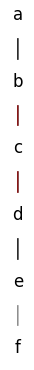
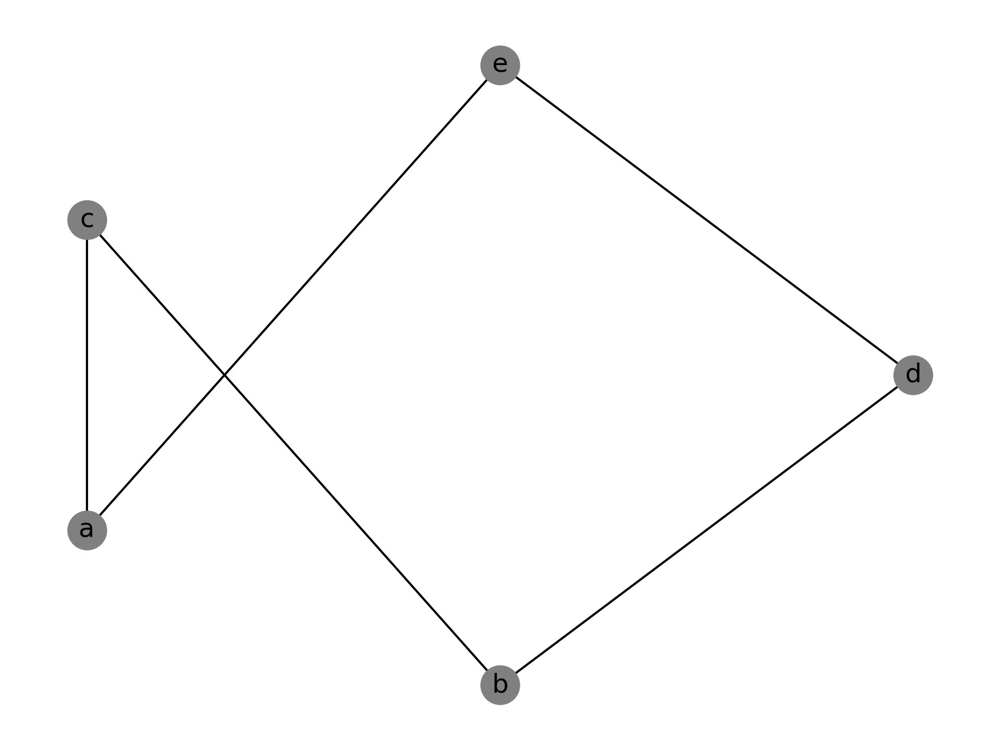
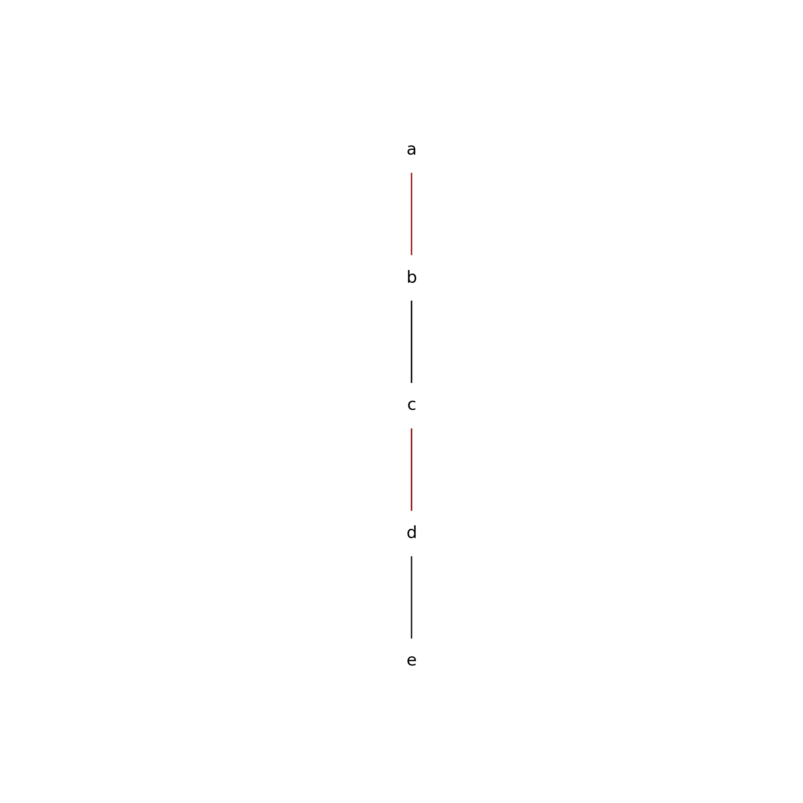

I asked ChatGPT:
> Write a Python script which takes a `networkx.DiGraph` object representing a partial order and plot it according to the rules of a covering diagram.

It responded by naming the chat session "Partial Order Plotting" and gave the following response:
> Sure, here's a Python script that takes a networkx.DiGraph object representing a partial order and plots it according to the rules of a covering diagram using matplotlib library:
```python

```

> This function takes a `networkx.DiGraph` object `dg` as input, and it computes the levels of the partial order using `nx.topological_sort()`. It then assigns positions to the nodes based on their level and position within the level, and adds edges for the covering relations. Finally, it uses matplotlib to plot the graph with the covering relations highlighted in red.
> You can call this function with your `networkx.DiGraph` object as follows:
```python

```
> This will create a plot of the partial order with a covering diagram.

After checking through the code for anything looking dangerous, I ran the code and it produced the following output:


As people like to say about ChatGPT, it is both impressive and imperfect. Let's go over some of it.

The first thing that struck me as odd was that it chose a total (i.e. linear) order. I would have been interested in seeing more arboricity in structure. 

I also don't see why running `dg.add_nodes_from(['a', 'b', 'c', 'd', 'e', 'f'])` makes any sense if you are going to run `dg.add_edges_from([('a', 'b'), ('a', 'c'), ('a', 'd'), ('b', 'e'), ('c', 'e'), ('d', 'e'), ('e', 'f')])` because NetworkX will actually add the needed nodes as it adds the edges.

Using `plt.show` is common for quick little plots, which I guess wasn't prohibited from what I asked. But I would rather that it return a [`matplotlib.pyplot.axis`](https://matplotlib.org/stable/api/_as_gen/matplotlib.pyplot.axis.html) object, or receive an axis object as a parameter to `covering_diagram`. 

It is completely reasonable that neither ChatGPT or a human would account for an unstated preference that the output plot have a transparent background, which can be accomplished by passing `transparent=True` to the [`matplotlib.pyplot.savefig`](https://matplotlib.org/stable/api/_as_gen/matplotlib.pyplot.savefig.html) command. I can't expect a machine to read my mind though! (Can I?)

And when it said "*Finally, it uses matplotlib to plot the graph with the covering relations highlighted in red.*" I was confused at first. But yes, some of the edges are coloured red according to whether it thought they were part of the covering relation on the input set.

It is appreciated that it attempted a docstring that seems to describe the general description of what the function is supposed to accomplish, but I didn't like that it said nothing about the parameters. Without context, how would I know what `dg` is supposed to be?

Offhand I don't know if the function is correct, but I would like to try some test cases on it.

Before doing that, I will replace `plt.show()` with `plt.savefig('chatgpt_cover_relation_plotter_output_test.png', dpi=300, transparent=True)` so I can confortably embed the output on this blog post. And now let us run this case

```python

```

which should produce an output similar to this:



but instead it outputs this:



In conclusion, this code doesn't work.
