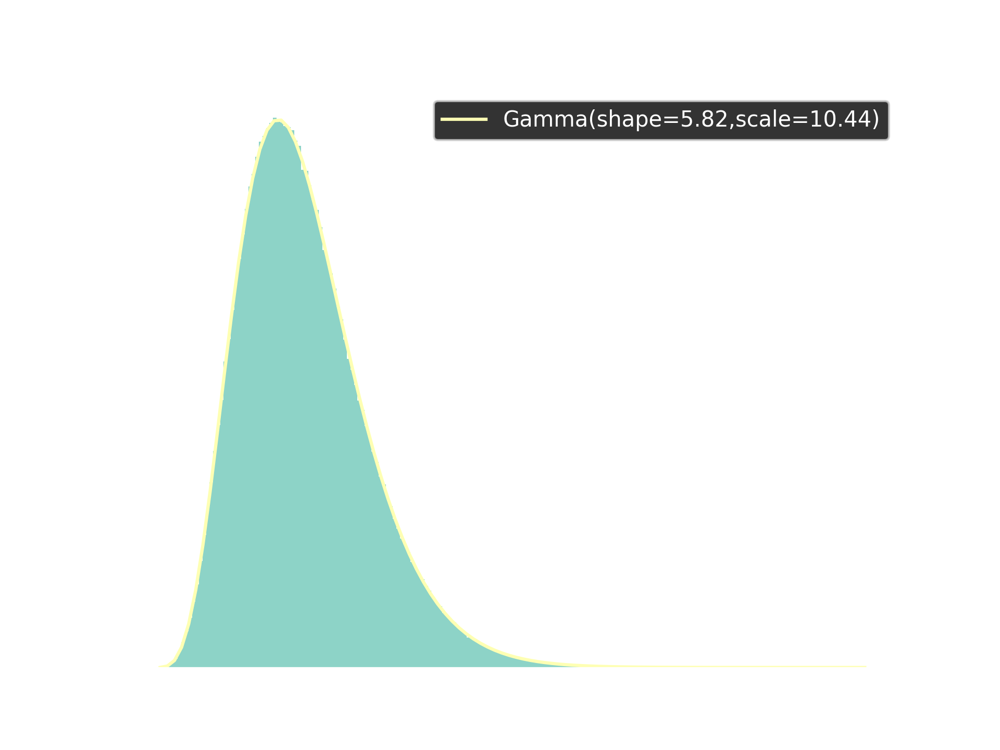

In this post we look at implementing SimPy's [Bank Renege](https://simpy.readthedocs.io/en/latest/examples/bank_renege.html) example using Ciw. At a first glance this example is essentially an [M/M/1 queue](https://en.wikipedia.org/wiki/M/M/1_queue), but it has a couple of custom features. The first customized aspect is reneging customers with a uniformly-distributed reneging patience. See [Bocquet 2005](https://apps.dtic.mil/sti/pdfs/ADA444342.pdf) for some discussion of basic queueing theory with reneging. The second aspect is that there is a fixed total number of customers.

Initially we could consider the arrivals to follow an exponential distribution

$$T_{\text{Arrivals}} \sim \text{Exponential} \left( \frac{1}{10}  \right)$$

but since this will only be true for the first 5 customers we need a more customized distribution. Specifically

$$T_{\text{Arrivals}} \sim \begin{cases}  \delta(\infty) & \text{Customers} \geq 5 \\ \text{Exponential} \left( \frac{1}{10}  \right) & \text{Customers} < 5  \end{cases}$$

where $\delta(\infty)$ denotes a [Dirac delta distribution](https://en.wikipedia.org/wiki/Dirac_delta_function) centered at infinity. You can consider this an abuse of notation that simply indicates that arrivals stop after 5 customers, or you could take a couple of distinct approaches: one defining this concept in terms of limits or the other in terms of the [extended real numbers](https://en.wikipedia.org/wiki/Extended_real_number_line). We'll just stick to it being an informal abuse of notation here. In Python we'll define this as `MaxArrivalDist`:

```python

```

Just so we don't simulate for too much or too little time, we can also set the termination condition of our simulation to be the number of customers that have left the system (i.e. have received service and left). Following the Ciw guide [*How to Simulate For a Certain Number of Customers*](https://ciw.readthedocs.io/en/latest/Guides/sim_numcusts.html) we can call the `simulate_until_max_customers(5, method='Finish')` method on an instance of `Simulation` to achieve this result. This way the `current_time` at the end of the simulation will be the amount of time for all five customers to sojourn.

The service distribution is just an exponential distribution:

$$T_{\text{Service}} \sim \text{Exponential} \left( \frac{1}{12} \right)$$

The reneging times for the customers will simply be according to a continuous uniform distribution:

$$T_{\text{Renege}} \sim \mathcal{U}_{[1,3]}.$$

Following Ciw guide [*How to Simulate Reneging Customers*](https://ciw.readthedocs.io/en/latest/Guides/reneging.html), we can simply pass in `reneging_time_distributions=[ciw.dists.Uniform(1,3)]`.


```python

```

How long should we expect this simulation to take? According to queueing theory, such a system is stable if $\rho \triangleq \frac{\lambda}{\mu} < 1$. In this case $\lambda = \frac{1}{10}$ and $\mu = \frac{1}{12}$ so $\rho = \frac{6}{5} > 1$. But there actually is something importantly different from this classic theoretical setting: we know ahead of time we're simulating for only 5 customers. So the theoretical concern of the length of the waitlist having unbounded asymptotic behaviour is not a concern here. That doesn't mean that the distribution is easy to estimate. One cannot, for example, simply add the random variables to get the correct distribution as that would ignore that there is waiting time on the queue and that some of the customers will renege. Instead, we'll simulate and record the simulation times that result.


```python

```

The above code results in the plot:



You may be wondering how I knew that it would be a Gamma distribution that would fit so well to the simulation results. Honestly, I guessed. Gamma distributions 'often' give good approximations to time-to-event distributions, and happen to generalize some common waiting time distributions such as [exponential distributions](https://en.wikipedia.org/wiki/Exponential_distribution) and [Erlang distributions](https://en.wikipedia.org/wiki/Erlang_distribution). Nonetheless, it is satisfying to see such a nearly-perfect fit to a relatively simple distribution.
