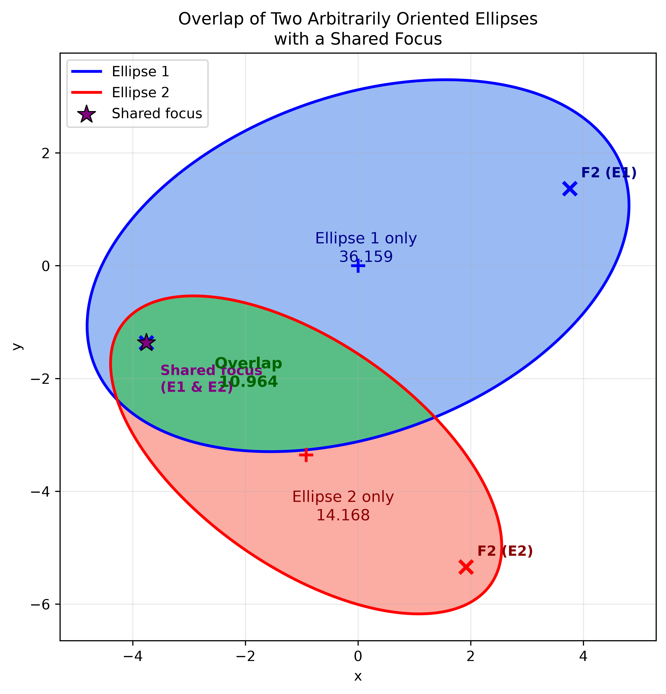
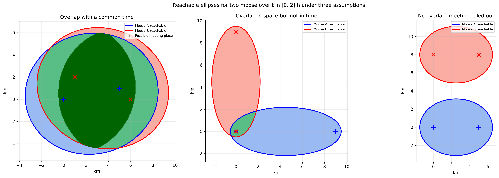

A GPS collar on a moose hands us a sequence of points: a latitude, a longitude, and a time. What it does not hand us is the path between those points. Between two consecutive fixes the moose could have wandered, rested, circled back, or run in a straight line, and all we observe is where it was at the two endpoints.

This is a familiar gap in movement ecology, and there is a classical geometric answer to a sharply-posed version of the question: *if the moose can move no faster than some maximum speed, where could it possibly have been between the two fixes?* The answer is an ellipse. And once we have ellipses for two animals, intersecting them gives a cheap first test of whether those animals could have crossed paths at all.

This post works through the geometry, the code, and the honesty required: the whole construction leans on an assumed maximum speed, and that assumption deserves scrutiny.

## The ellipse between two fixes

Let a moose be observed at position $x_0$ at time $t_0$ and at position $x_1$ at time $t_1$. Write the interval length as

$$\Delta t = t_1 - t_0.$$

Suppose the moose can never travel faster than a maximum speed $v_{\max}$. A point $p$ was *possible* for the moose at some moment in the interval only if there is a route from $x_0$, through $p$, then on to $x_1$, whose total length fits in the time available. The shortest such route is two straight segments, so the condition is

$$\lVert p - x_0 \rVert + \lVert p - x_1 \rVert \le v_{\max}\,\Delta t.$$

That inequality is precisely the definition of the interior of an ellipse with foci at the two fixes. The sum of distances to the foci is constant, and here the constant is the total distance the moose can cover. So the set of possible positions is a filled ellipse whose foci are the two fixes, with

$$2a = v_{\max}\,\Delta t, \qquad c = \frac{\lVert x_1 - x_0 \rVert}{2}, \qquad b = \sqrt{a^2 - c^2},$$

where $a$ is the semi-major axis, $c$ the focal distance, and $b$ the semi-minor axis. The major axis lies along the line joining the fixes. This object has a name in time geography: the **potential path area** for a single time step. It is a *region of possibility*, not a probability distribution, and not a path.

Some immediate consequences fall out of the formula. If $v_{\max}\,\Delta t < \lVert x_1 - x_0 \rVert$ then the inequality can never hold and the ellipse does not exist: the fixes are mutually inconsistent with the speed assumption, which usually means the speed bound is too low or the fixes carry enough error to make the implied speed misleading. And as $\Delta t$ grows, the ellipse grows linearly in its long direction, so the method loses power exactly when fixes are sparse.

## Drawing and intersecting ellipses

Analytic ellipse intersections are fiddly, but computational geometry libraries handle them directly. The script below builds an ellipse by buffering a point to a unit disc and then scaling, rotating, and translating it with Shapely, computes the foci, and takes the set operations we care about: intersection for the shared area, difference for the exclusive areas.

```python

```

The example uses two arbitrarily oriented ellipses that happen to share a focus, and reports the areas of each ellipse only, each intersection, and the overlap. Sharing a focus is a nice special case to look at because the foci are the anchor points of the construction, and it makes the geometry easy to read off the figure.



For the moose question the shared-focus case has a natural interpretation: if two consecutive fixes of a single moose happened to coincide with one focus of two successive ellipses, then the two intervals are stitched together at that point. More generally, for a single animal we get a chain of ellipses, one per interval, and the union of those ellipses is the animal's potential path area across the whole tracking period.

## Two moose: could they have met?

Now give two moose each a pair of fixes over the same interval, and give each its own maximum speed. Moose A gets ellipse $E_A$ and moose B gets $E_B$. A first, purely spatial question:

- If $E_A \cap E_B = \varnothing$, then there is no location that both animals could have occupied during the interval, so under these assumptions a meeting is **ruled out**. This is a genuinely useful negative result.
- If $E_A \cap E_B \neq \varnothing$, then a shared location is possible, and it is tempting to conclude that an interaction was possible. That conclusion is too quick.

The reason is that the ellipse is time-agnostic. It is the union, over every moment in the interval, of the positions the animal could have occupied. Two animals can have overlapping ellipses while being at the same place at disjoint times, which is not an interaction at all.

The sharper question uses the time axis. A moose that must be at $x_0$ at $t_0$ and at $x_1$ at $t_1$ can be at a point $p$ at time $t$ only if it can get there and still get to $x_1$ afterwards:

$$t_0 + \frac{\lVert p - x_0 \rVert}{v_{\max}} \;\le\; t \;\le\; t_1 - \frac{\lVert p - x_1 \rVert}{v_{\max}}.$$

That is a window of possible presence at $p$. The two moose could have met at $p$ only if their windows overlap, that is, if

$$\max\bigl(\text{lo}_A, \text{lo}_B\bigr) \;\le\; \min\bigl(\text{hi}_A, \text{hi}_B\bigr).$$

A meeting is possible if such a $p$ exists anywhere in the overlap region. The script below builds the reachable ellipses, intersects them, and then grids the overlap looking for points where both windows overlap. It runs three cases: an overlap that does support a common time, an overlap that exists in space but never in time, and no overlap at all.

```python

```



The three panels make the point better than prose. In the first, the fast-moving animals have fat ellipses that overlap generously and there are many candidate meeting places, with the widest window at roughly $(3.0, 1.2)$ km lasting from about $t = 0.54$ h to $t = 1.64$ h. In the second, one moose is committed to crossing the interval eastwards and the other southwards, and the small overlap near the shared endpoint is only reachable by the first animal at the start of the interval and by the second at the end, so the spatial overlap never coincides with a temporal overlap. In the third, the two corridors are far enough apart that even a generous speed limit leaves the ellipses disjoint, so the meeting is impossible under that speed bound.

## Strengths

- **Cheap and closed-form.** Two fixes, one speed, and a formula give an answer. No fitting, no simulation, no parameters beyond the speed bound.
- **Interpretable and auditable.** Every component has a physical meaning, and a biologist can argue with the speed assumption directly rather than interpreting a fitted diffusion coefficient.
- **Sound for ruling things out.** A non-intersection is a real, assumption-conditional impossibility result. That makes the method a good screen before committing to expensive movement models.
- **Composable.** Ellipses chain across intervals into a potential path area for a whole tracking period, and the same formula generalises to any distance metric you like.
- **Bridges behavior and data.** It turns sparse telemetry into an explicit statement about what interaction is and is not consistent with the data.

## Limitations

The most consequential assumption is **the maximum speed itself**, and it cuts both ways. If $v_{\max}$ is too high, the ellipses inflate and the test almost never rules anything out; if it is too low, feasible meetings are falsely excluded and the fixes look impossible. Real moose speeds depend on terrain, snow depth, season, sex, presence of a calf, and whether the animal was fleeing a predator or crossing a road. There is no single correct value, and the honest approach is to report results across a range of plausible speeds and to show where conclusions flip. The examples above make this concrete: the same fix pairs give a permitted meeting at one speed and a ruled-out meeting at another.

Beyond the speed assumption:

- **Barriers and habitat.** The construction assumes straight-line reachability and ignores lakes, rivers, cliffs, highways, and fences. It can therefore be optimistic in exactly the places where a landscape matters. Least-cost or path-based distances can fix this, but then the reachable region is generally not an ellipse anymore.
- **It is a region, not a path.** The ellipse is the union of positions across all moments, so it is much larger than any real trajectory, and it grows linearly with the interval. For widely spaced fixes it may be uselessly large.
- **Location error propagates.** Fixes are uncertain, so the foci are really discs of error rather than points, and the true region is the ellipse dilated by roughly that error radius. Fix error can also make the implied speed exceed $v_{\max}$, producing the "impossible" case above. A proper treatment inflates the ellipses and reports intervals rather than point estimates.
- **Geometry versus probability.** The method makes no statement about likelihood. It answers "could" rather than "did" or "probably". Interaction also requires more than co-location; two moose standing in the same meadow at the same minute have not necessarily interacted.
- **Temporal resolution and aliasing.** Whether an interaction is even detectable depends on the sampling interval relative to how long an encounter lasts. Coarse sampling gives large ellipses and weak power; fine sampling gives short intervals and narrow ellipses but more of them.
- **Independence assumptions.** With two independently tracked animals, both the movement and the error are typically treated as independent, which may fail when both carry the same satellite clock error or move in response to the same weather.
- **Planar approximation.** Coordinates must be projected into a local metric frame, and distances should be computed in that frame rather than in raw degrees.

## What I would do with this in practice

Use the ellipses as the first pass. They are fast, transparent, and they fail safely in the sense that a non-intersection is informative. Then bring in the machinery that does the hard parts: continuous-time movement models or Brownian-bridge movement models to replace "possible" with a probability, a landscape cost surface to replace straight-line distance, and a proper error model in place of point fixes. The ellipse construction earns its place by telling you, quickly, which pairs of animals and which intervals are even worth the effort.

The broader lesson is the same one that shows up whenever data are sparse: the connection between two observations is not an observation, and any inference about what happened in between is only as good as the assumptions you are willing to defend. The maximum-speed ellipse is a very defensible assumption, as long as you remember it is an assumption and not a fact.
