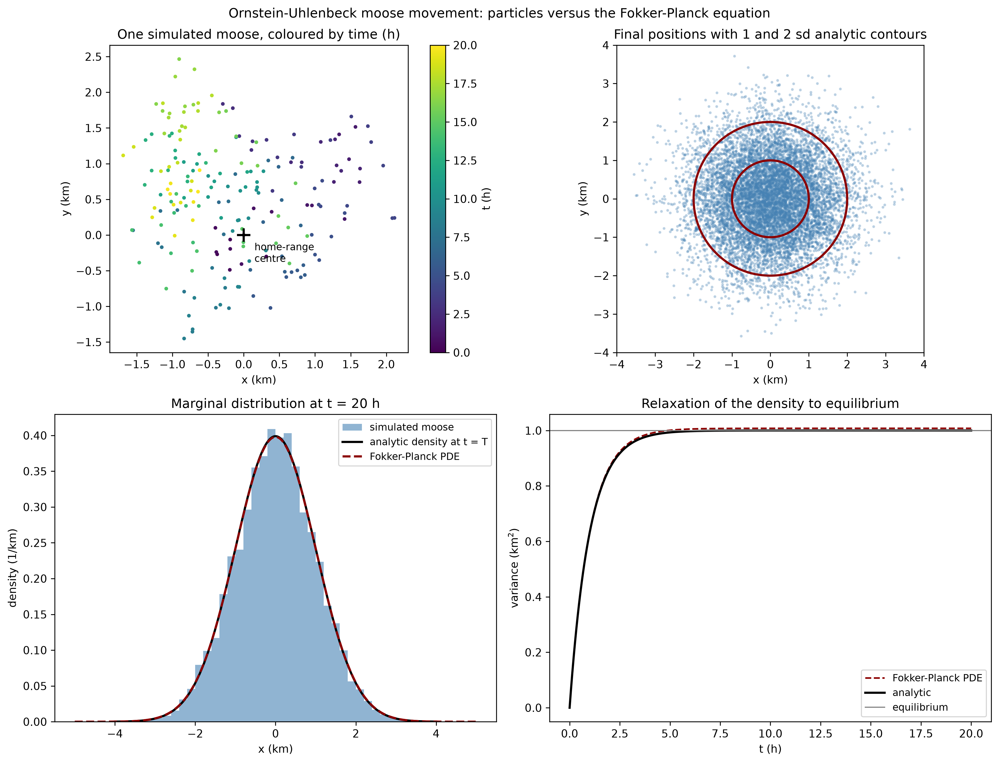

In a [previous post](https://galenseilis.github.io/blog/posts/ellipse-intersections-for-moose-movement/) I used ellipses to put hard bounds on where a moose could have been between two GPS fixes, assuming only a maximum possible speed. That approach answers "where could it *not* have been" and never says anything about likelihood. This post is about the complementary probabilistic tool, and about the single most widely used stochastic model of animal movement: the **Ornstein-Uhlenbeck (OU) process**.

The OU process is a diffusion with a linear restoring force. Interpreted for moose, it says that the animal is pulled back towards a home-range centre and buffeted by random motion, and it is the special case of the general Fokker-Planck framework in which the density stays Gaussian and every quantity of interest is available in closed form. That tractability is exactly why it is a natural first model, and also why it is too restrictive to be the last one. In the [next post](https://galenseilis.github.io/blog/posts/general-fokker-planck-moose-movement/) I lift the restrictions one at a time and build a general Fokker-Planck model of moose movement; this post establishes the baseline that the general model has to beat.

## From paths to densities

Start with the individual. An It\^o stochastic differential equation (SDE) says that a small change in position over a small change in time has a predictable part and a random part:

$$dX_t = \mu(X_t, t)\,dt + \sigma(X_t, t)\,dW_t,$$

where $\mu$ is the drift vector, $\sigma$ the diffusion matrix, and $W_t$ a Wiener process (Brownian motion). Each sample path of this SDE is a plausible trajectory for one animal: drift is the average or directed motion, diffusion is the unpredictable jitter.

The density $p(x, t)$ of where the animal is likely to be then obeys the **Fokker-Planck equation** (also called the Kolmogorov forward equation):

$$\frac{\partial p}{\partial t} = -\nabla \cdot \bigl(\mu\, p\bigr) + \frac{1}{2}\,\partial_i \partial_j \bigl(D_{ij}\, p\bigr), \qquad D = \sigma\sigma^{\top}.$$

The SDE and the Fokker-Planck equation are two descriptions of the same stochastic process: the SDE is the language of paths, the PDE the language of densities. The OU process is what you get when the drift is *linear* and the diffusion is *constant and isotropic*.

## The Ornstein-Uhlenbeck model

Moose are not diffusing gas molecules, but they do have a strong tendency to stay within a home range. The OU model encodes that with a drift that pulls the animal back towards a centre $c$,

$$\mu(x) = -\kappa\,(x - c),$$

so that far from the centre the drift is large and inward, and near the centre it is negligible. The two parameters have clear interpretations:

- $\kappa > 0$ is the **fidelity** to the home range, in units of $1/\text{time}$. Its reciprocal $1/\kappa$ is the characteristic time over which the animal forgets its current position and relaxes back towards the centre. It is the relaxation or memory time.
- $\sigma$ is the **restlessness**, in units of $\text{distance}/\sqrt{\text{time}}$. It is not a speed: it is the strength of the random component, and its units are those of a diffusion coefficient's square root.

Because the drift is linear and the noise is constant, the model is exactly solvable. The stationary distribution of positions is Gaussian,

$$p_\infty(x) = \frac{1}{\sqrt{2\pi s^2}}\exp\!\left(-\frac{(x-c)^2}{2s^2}\right), \qquad s^2 = \frac{\sigma^2}{2\kappa},$$

so the home-range size $s$ is set by the ratio of restlessness to fidelity. In two dimensions the same model gives an isotropic Gaussian around $c$ with per-axis standard deviation $s$, so the radius from the centre follows a Rayleigh distribution with mean $s\sqrt{\pi/2}$. The full time-dependent solution is also known exactly: starting from a point at the centre, the position at time $t$ is Gaussian with mean $c$ and variance

$$s^2(t) = \frac{\sigma^2}{2\kappa}\left(1 - e^{-2\kappa t}\right),$$

which approaches $s^2$ at rate $\kappa$. This is the property that makes the OU model the reference point: from two numbers, $\kappa$ and $\sigma$, and a centre, you can write down the entire distribution at any time.

## Simulating the paths

The Rust program below simulates a virtual population of moose as two-dimensional OU processes with an Euler-Maruyama scheme, which is the standard first-order discretization of an SDE. It depends only on the `rand` and `rand_distr` crates. Parameters are in kilometres and hours: a fidelity of $\kappa = 0.5\ \text{h}^{-1}$ (a two-hour memory), a restlessness of $\sigma = 1.0\ \text{km}/\sqrt{\text{h}}$, and a time step of $36$ seconds over twenty hours. Every moose starts at the home-range centre.

```rust

```

```text
Movement model: dx = -kappa (x - c) dt + sigma dW   (Ornstein-Uhlenbeck)
kappa = 0.500 1/h, sigma = 1.000 km/sqrt(h), dt = 0.0100 h, steps = 2000 (T = 20.0 h)
10000 virtual moose, seed 20261016, home-range centre at 0.0 km
Analytic stationary sd per axis: sigma / sqrt(2 kappa) = 1.000 km

Final positions at t = T:
quantity                     simulated  analytic
mean x (km)                     -0.003     0.000
mean y (km)                     -0.002     0.000
sd x (km)                        1.003     1.000
sd y (km)                        1.008     1.000
mean radius from centre (km)     1.261     1.253

Marginal distribution of x (each * is about 40 moose):
-3.00 to -2.50 | * (40)
-2.50 to -2.00 | **** (173)
-2.00 to -1.50 | ************ (480)
-1.50 to -1.00 | *********************** (930)
-1.00 to -0.50 | ************************************ (1446)
-0.50 to  0.00 | *********************************************** (1898)
 0.00 to  0.50 | ************************************************* (1979)
 0.50 to  1.00 | ************************************ (1449)
 1.00 to  1.50 | ********************** (908)
 1.50 to  2.00 | *********** (450)
 2.00 to  2.50 | **** (169)
 2.50 to  3.00 | * (45)
```

Even at this coarse resolution the simulated moments match the analytic stationary values to within about a percent. This is a numerical check of the theory: the Wiener process was the only randomness in the program, and out of it came the Gaussian equilibrium predicted by the analytics. Notice, though, that the program *integrates the SDE*, not the density equation. The comment in the original scratch version of this code called the Euler-Maruyama update a "Fokker-Planck update step", which is a common slip: the particles carry the density, but the equation they satisfy collectively is a different one.

## The density equation for the OU model

To get the density equation itself onto the page, the Python script below solves the one-dimensional Fokker-Planck equation for the OU model on a grid with an explicit finite-volume scheme. The probability current is

$$J = -\kappa\,(x - c)\,p - \frac{\sigma^2}{2}\frac{\partial p}{\partial x},$$

and it is discretized in flux form with the advective part upwinded and the diffusive part centred. The flux is set to zero at the walls, so total probability is conserved exactly, and the initial condition is a point mass at the centre. The script then compares three things: the simulated moose from the Rust program, the numerical PDE solution, and the analytic Gaussian.

```python

```



The three routes to the answer agree. The printed diagnostics are:

```text
Fokker-Planck PDE versus analytic solution:
  mass at T:          1.000000 (should be 1.000000)
  PDE variance at T:  1.007964
  analytic variance:  1.000000
  PDE mean at T:      -0.000000
  analytic mean:      0.000000
```

The mass is conserved to machine precision, as it must be for a no-flux boundary. The variance is high by about $0.8\%$, and the reason is instructive: first-order upwinding of the drift term adds an artificial diffusion of size roughly $|v|\,\Delta x/2$. Halving the grid spacing roughly halves that bias. This is a reminder that "solving the Fokker-Planck equation numerically" always means solving *a discretization* of it, and the discretization has its own physics.

## Properties of the OU model

The OU model's special structure is what makes it both useful and, in the end, restrictive.

- **Exact solvability.** Linear drift and constant diffusion keep the density Gaussian forever. The stationary and transition densities are normal, so predictions are closed-form.
- **A Gaussian home range.** The stationary distribution is a single isotropic bell centred on $c$ with standard deviation $s = \sigma/\sqrt{2\kappa}$. Its area is a home-range size, and its contours are a utilization distribution. It has no notion of shape beyond a circle.
- **Exponential relaxation with a spectral gap.** The Fokker-Planck operator for the OU model has Gaussian eigenfunctions with eigenvalues $-n\kappa$, so every deviation from equilibrium decays at a known exponential rate and the slowest mode is $1/\kappa$. Equilibrium is approached, and how fast is computable.
- **Closed moment equations.** The mean relaxes to $c$ like $e^{-\kappa t}$ and the variance approaches $s^2$ like $e^{-2\kappa t}$, so the first two moments can be tracked without solving the PDE at all.
- **Reversibility.** The OU process is in detailed balance: in equilibrium, every microscopic transition is balanced by its reverse, and there is no net circulation of probability. This is a strong restriction, and general models lose it.
- **Positivity and conservation.** As for any Fokker-Planck model, $p \ge 0$ is preserved and total probability is conserved with no-flux boundaries. Adding a sink term turns it into a model of mortality or of animals leaving the study area.
- **Infinite propagation speed.** For $\sigma > 0$ the equation is parabolic, so a point mass immediately has nonzero density everywhere. The moose could be anywhere, with minuscule but positive probability immediately, no matter how fast it would have to travel. This is in direct tension with the hard maximum-speed bound of the ellipse method.
- **A diffusion limit.** Without drift the model is Brownian motion and the variance grows linearly, $2Dt$. The OU process is the mean-reverting version of that random walk, which is why it sits underneath both random-walk models and macroscopic diffusion models.

## Strengths of the OU model

- **Interpretable parameters.** Fidelity and restlessness are statements about the animal, not statistical conveniences, and they carry units a field biologist can reason about.
- **Closed-form answers for useful quantities.** Home-range size, the time to settle, the overlap of two home ranges, and the expected time to encounter a fixed feature are all available without simulation.
- **A utilization distribution for free.** The stationary density is what home-range and habitat analyses actually want, produced from two individual-level parameters.
- **It fits data.** Because the transition density is Gaussian, the OU model is a linear Gaussian state-space model: it can be fitted to irregularly-spaced collar fixes by maximum likelihood or Kalman filtering, with measurement error handled explicitly [@hooten2017animal].
- **It is the right null model.** In movement ecology the mean-reverting diffusion is the baseline against which more elaborate models are compared, much as Brownian motion is the baseline in phylogenetics.
- **It is a bridge.** The OU process links individual movement rules to redistribution patterns through the continuum limit in the movement ecology literature [@turchin1998quantitative; @nathan2008movement].

## Defects of the OU model

Every strength above is also a defect when the animal does not cooperate, and moose mostly do not.

1. **The home range is a single Gaussian blob.** Real ranges are often multi-modal, elongated along valleys and ridges, and asymmetrical. An isotropic OU process cannot represent any shape.
2. **The drift is linear.** There is no habitat in the model. Food, cover, and terrain should bend the drift, not a spring to a point.
3. **The diffusion is constant and isotropic.** Movement is equally easy in all directions and everywhere, which is false across snow, muskeg, forest, and open ground, and false along corridors.
4. **There are no boundaries.** Rivers, lakes, highways, fences, and cliff lines are invisible to the model, even though they dominate where a moose can go.
5. **There are no interactions.** The model describes one animal in a fixed environment. It cannot represent avoidance of conspecifics, a cow and calf staying together, or predator risk.
6. **There is no memory or behaviour.** The process is Markovian with white noise and Gaussian steps. Real moose have behavioural states, autocorrelated moves, and heavy-tailed excursions that a single $\sigma$ cannot produce.
7. **The parameters are constant.** Real fidelity and restlessness vary with season, snow, rut, and time of day. A stationary model over months is an average that may describe no moose in particular.
8. **Only one animal at a time.** Turning the density into a population model requires either independent copies (ignoring interaction) or coupling.
9. **It grants infinite speed,** as noted above, so it is not a physical bound and can assign probability to impossible jumps.

The [next post](https://galenseilis.github.io/blog/posts/general-fokker-planck-moose-movement/) repairs these one at a time by writing the Fokker-Planck equation in its general form: a habitat potential instead of a spring, a spatial diffusion field instead of a constant, barriers as boundary conditions, interactions as nonlocal couplings, behaviour as multiple states, and jumps as fractional diffusion.

## Conclusion

The Ornstein-Uhlenbeck process is the natural first model of a moose with a home range: two interpretable parameters, an exact Gaussian answer, a known relaxation rate, and a clean path to fitting collar data. It is also a caricature. The rest of this series generalizes the density equation until the model can carry habitat, barriers, interactions, behaviour, and jumps, using the OU model as the baseline whose defects define the agenda.
