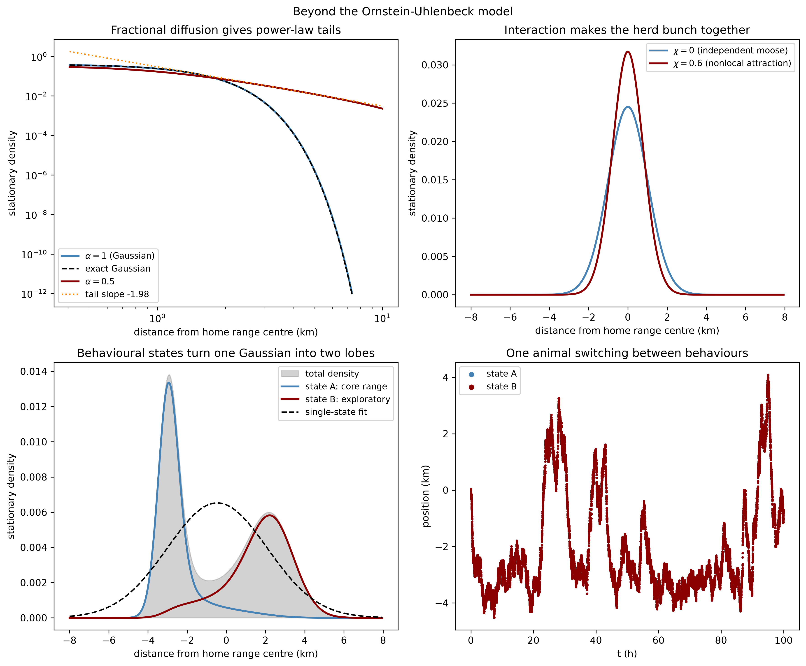

In the [previous post](https://galenseilis.github.io/blog/posts/fokker-planck-moose-movement/) I built the Ornstein-Uhlenbeck (OU) model of a moose with a home range, and ended with a list of nine defects and a promise: rebuild the model in the general Fokker-Planck form, repairing the defects one term at a time. That is this post. The OU model was the special case in which the drift is a spring, the diffusion is a constant, and everything stays Gaussian and closed-form. The general equation is the framework in which habitat, barriers, interactions, behavioural states, and jumps can all be written down explicitly. The price is that almost nothing in it is solvable by hand: every result below is computed numerically.

## The general equation

The Fokker-Planck equation for the density $p(x,t)$ of an animal's position, in the form that can carry all of the repairs at once, is

$$\frac{\partial p}{\partial t} = -\nabla \cdot \bigl(b[x,p]\, p\bigr) + \frac{1}{2}\,\partial_i \partial_j \bigl(D_{ij}(x)\, p\bigr) - \lambda(x)\,p.$$

Compared to the equation in the previous post, three things have become general. The drift $b$ may depend on space through a habitat field and on the density itself through a nonlocal coupling. The diffusion $D_{ij}$ is a field rather than a constant, so movement can be easier in some terrain than others. The sink term $\lambda$ removes mass, modelling mortality or animals leaving the study area. Each change answers a specific defect from the OU list:

1. **Habitat instead of a spring** (defects 1 and 2). Write the drift as $b = -\nabla U$ for a habitat potential $U$, large where habitat is poor. The potential-function approach to movement is standard in ecology [@preisler2013analyzing]; nothing forces $U$ to be quadratic or its level sets to be circles, so the home range can be multi-modal and shaped like the landscape.
2. **A diffusion field** (defect 3). $D(x)$ varies across snow, muskeg, forest, and open ground, and along corridors.
3. **Barriers as boundary conditions** (defect 4). Rivers, lakes, and highways become walls on which the probability current is set to zero, with gaps where crossing is possible.
4. **Interactions as nonlocal coupling** (defect 5). Each animal climbs the local density of conspecifics, $b[x,p] = -\nabla U + \chi \, \nabla \log (G * p)$, where $G$ is a smoothing kernel and $\chi$ the attraction strength. This is a mean-field stand-in for the local attraction and alignment rules that organize real groups [@couzin2002collective].
5. **Behaviour as multiple states** (defects 6 and 7). Run several densities $p_i$ at once, each with its own potential and diffusivity, coupled by switching rates $q_{ij}$. A moose alternates between a tight core range and a wider exploratory mode; the observable density is the mixture.
6. **Jumps as fractional diffusion** (defect 9). Replace the Laplacian by the fractional Laplacian of order $2\alpha$, so the diffusion term becomes $D\,(-\Delta)^{\alpha} p$ with $\alpha = 1$ the Brownian case and $\alpha < 1$ a process that makes occasional long relocations [@metzler1994fractional; @xie2015nonlocal].

One property of the OU model survives generalization and becomes the workhorse check for everything below. With a constant scalar $D$ and no-flux walls, the current $J = -\nabla U\, p - D \nabla p$ vanishes identically for the **Boltzmann equilibrium**

$$p_\infty(x) \propto \exp\!\left(-\frac{U(x)}{D}\right),$$

which reduces to exactly the Gaussian of the previous post when $U$ is the spring $\kappa(x-c)^2/2$ and $D = \sigma^2/2$. For constant $D$, habitat alone determines where the animal concentrates; the numerical question is whether the scheme reproduces it.

## Experiment 1: habitat, a river, and a bridge

The Python script below puts the general equation on a two-dimensional landscape: a $4 \times 4$ km domain on an $81 \times 81$ grid with two Gaussian habitat wells (two home ranges), a river along $x = 2$ km with a single bridge near $y = 0.7$ km, and constant $D = 0.5\ \text{km}^2/\text{h}$. All density starts in the left well. Three experiments are run: relaxation to equilibrium with and without the river, and a final run in which $D(x)$ has a hot spot of easier movement near the right well, where the Boltzmann formula no longer applies.

```python

```


Three things are visible in the figure and confirmed by the printed diagnostics.

**The equilibrium is bimodal.** With two wells, $e^{-U/D}$ has two humps. Defect 1 is repaired by construction: multi-modal utilization distributions are ordinary output, not something the modeler has to disbelieve.

**The river slows mixing but does not change the equilibrium.** No-flux walls cannot change a zero-current solution, so both landscapes relax towards the same $p_\infty$; what the river changes is how long redistribution takes. Measured in total-variation distance to equilibrium:

```text
Barrier delays mixing:
  t =   2.0 h   TV to equilibrium: barrier 0.4884   no barrier 0.3573
  t =   5.0 h   TV to equilibrium: barrier 0.4625   no barrier 0.2031
  t =  10.0 h   TV to equilibrium: barrier 0.4218   no barrier 0.0819
  t =  20.0 h   TV to equilibrium: barrier 0.3508   no barrier 0.0485
  t =  40.0 h   TV to equilibrium: barrier 0.2427   no barrier 0.0479
  t =  60.0 h   TV to equilibrium: barrier 0.1679   no barrier 0.0479
```

After sixty hours the free landscape has essentially settled while the riverine one is still far from it: the bridge is the only channel, and mixing is gated by its width. For management this is the difference between where animals will eventually be and where they can be reached in a season.

**The solver has its own physics, again.** With the river removed, the numerical steady state is compared against $e^{-U/D}$ directly:

```text
Solver validation (constant D, no barrier):
  max relative error versus exp(-U/D): 0.1683
  TV distance at t = 60 h:             0.04789
```

The error is not concentrated in the tails: the median relative error over open cells is about $0.155$, because first-order upwinding of the drift adds an artificial diffusion of size roughly $|b|\,\Delta x/2 \approx 0.06\ \text{km}^2/\text{h}$ against a physical $D = 0.5$ — a twelve percent inflation of the effective diffusivity. Refining the grid from $81^2$ to $161^2$ halves both the median relative error ($0.155 \to 0.078$) and the total-variation distance ($0.048 \to 0.024$), the first-order convergence the scheme owes. This is the same lesson as in the OU post, now in two dimensions: solving the Fokker-Planck equation always means solving a discretization of it.

Finally, the variable-diffusion run. Where $D$ varies, $e^{-U/D_0}$ is no longer the stationary density:

```text
Variable diffusion versus the constant-D Boltzmann prediction:
  median ratio p_steady / (exp(-U/D0) normalised): 1.461
  interquartile range of ratio:                    0.721
  correlation of log p with -U/D0:                 0.943
```

The potential still organizes the density — the correlation stays high — but no longer determines it: the equilibrium is shifted by almost fifty percent at the median, with a spread of the same order. There is no universal closed-form equilibrium left to check a solver against; where movement ease varies across a landscape, the pattern of $D$ matters as much as the pattern of $U$, and solving the PDE is not optional.

## Experiment 2: three repairs in one dimension

The second script isolates three of the general mechanisms in one dimension, where each can be checked against something.

```python

```



**Fractional diffusion gives the moose heavy tails.** The stationary density of the fractional OU flow is computed by a split scheme: each step applies the exact Ornstein-Uhlenbeck contraction, remapped conservatively from cell to cell, and then the exact fractional diffusion in Fourier space. As a check, $\alpha = 1$ must reproduce the ordinary Gaussian, and does, to a total-variation distance of $0.0037$ over twenty thousand steps with mass drift at the $10^{-12}$ level. For $\alpha = 0.5$ the stationary density is no longer Gaussian in the tails:

```text
Fractional OU, 20000 split steps of 0.005 h, 2048 points on [-16, 16) km
  alpha = 1:   mass drift over the run 9.237e-12
  alpha = 0.5: mass drift over the run 2.734e-12
  alpha = 1 TV distance to the exact Gaussian: 0.0037
  alpha = 0.5 tail fit on 2.5-6 km: slope -1.985 (predicted -2.000)
```

A fitted tail slope of $-1.985$ against the predicted $-(1+2\alpha) = -2$: the fractional moose still concentrates near its centre, but its rare multi-kilometre relocations occur at a power-law rate rather than the astronomical improbability the Gaussian assigns them. The numerical point worth keeping is that the flow step must be conservative. On the periodic domain used here the OU contraction points strictly inward, so the exact one-step map folds nothing across the seam; treating it as a wrap-around contraction would manufacture mass on every step, and the scheme would explode.

**Nonlocal attraction makes the herd bunch together.** With the interaction drift $\chi \, \partial_x \log(G*p)$, the equilibrium can still be predicted: for a Gaussian $p$ of variance $v$, the smoothed density $G*p$ is Gaussian of variance $v + w^2$, so $\log(G*p)$ is exactly quadratic and the self-consistency condition closes,

$$v = \frac{D}{\kappa + \chi/(v + w^2)}.$$

For $\chi = 0.6\ \text{km}^2/\text{h}$ and interaction width $w = 0.5$ km its fixed point is $v = 0.581$, down from the non-interacting value of $1$. The simulation:

```text
Nonlocal attraction chi = 0.6 km^2/h, interaction width 0.5 km
  converged after 9.1 h (chi = 0) and 8.8 h (chi = 0.6)
  final TV change: 8.31e-11 and 7.78e-11
  variance: no interaction 1.050, with interaction 0.632
  self-consistent Gaussian prediction: 0.581
  TV distance from that prediction: 0.018
  TV distance between the two equilibria: 0.122
```

The interacting equilibrium sits within $0.018$ of the predicted Gaussian; the residual, and the gap between $0.632$ and $0.581$, come from the same upwind numerical diffusion that inflated the free variance to $1.050$ in the first place. The two equilibria are $0.122$ apart in total variation: animals that pay attention to each other occupy a visibly tighter range than the same animals alone.

**Behavioural states turn one Gaussian into two lobes.** The last experiment couples two state equations: state A is a core range ($\kappa = 1\ \text{h}^{-1}$, $D = 0.25\ \text{km}^2/\text{h}$, centre $-3$ km), state B an exploratory mode ($\kappa = 0.5\ \text{h}^{-1}$, $D = 0.6\ \text{km}^2/\text{h}$, centre $+2.5$ km), with symmetric switching at $0.1\ \text{h}^{-1}$ — a typical ten hours per state:

```text
Two behavioural states, 100 h of switching (10 h typical per state)
  mass in state A 0.500000, state B 0.500000
  change between t = 60 h and t = 100 h: TV 4.14e-06
  mixture mean -0.462 km, sd 2.553 km
  TV distance from a single Gaussian with the same mean and sd: 0.340
  density at the midpoint versus the highest mode: 0.184
  example path: 0.261 of the time in the wide mode
```

By $t = 60$ h the mixture is stationary. Its total density has two lobes with a dip at the midpoint to $0.184$ of the peak height, and it is $0.340$ away from the best single Gaussian with the same mean and variance — far beyond any discretization error. This is the quantitative form of the argument that made switching state-space models standard in movement ecology [@jonsen2007switching; @patterson2009classifying]: a single-state model fitted to such an animal invents a home range centred in the gap between the two lobes, habitat the moose in fact avoids.

## What generality does not buy

Repairs have prices, and honesty requires listing them.

- **None of this is fitted.** Every parameter above was chosen to make the mechanism legible. The OU model at least admitted likelihood fitting through its Kalman filter; the general equation loses the linear-Gaussian structure that made that cheap [@hooten2017animal]. Model inference, not model construction, is now the bottleneck.
- **Identifiability is the next wall.** The equilibrium is shaped jointly by $U$ and $D$, and from positions alone good habitat is hard to distinguish from easy movement. Multi-lobed densities are produced by multi-modal potentials, by behavioural switching, by heavy tails, and by interactions alike; distinguishing mechanisms will need transients or multi-animal data, not just stationary utilizations.
- **Infinite speed is not repaired, only reinterpreted.** Fractional diffusion replaces Gaussian steps with explicit jumps, but the operator is nonlocal in space, so influence still propagates instantly. The hard maximum-speed bounds from the [first post](https://galenseilis.github.io/blog/posts/ellipse-intersections-for-moose-movement/) live outside any Fokker-Planck model and remain complementary to it.
- **It is still a stationary framework.** Season, snow, and rut enter here only through the choice of behavioural states, not as explicit time-dependence; defect 7 is partially, not fully, answered.
- **It costs compute.** Two-dimensional grids, nonlocal couplings, and fractional operators turn closed forms into matrix and FFT work. Minutes on a laptop for the toy domains here; realistic landscapes demand more.

## Conclusion

The defect list from the Ornstein-Uhlenbeck post served as a specification, and term by term the general Fokker-Planck equation carries what the OU model could not: a habitat potential that makes the home range multi-modal, a diffusion field that makes terrain matter, barriers that gate mixing through single crossings, conspecific attraction that tightens ranges, behavioural states that split one utilization distribution into two, and fractional diffusion that gives rare relocations a power-law rate. The OU model is not discarded — it survives as the special case these terms are switched off into, and as the null model every term is measured against. What is given up is everything that made the OU model computable: the Gaussian, the closed form, the filter. The next serious step is turning from model construction to model fitting, putting real collar fixes on the likelihood of some chosen subset of these terms.
