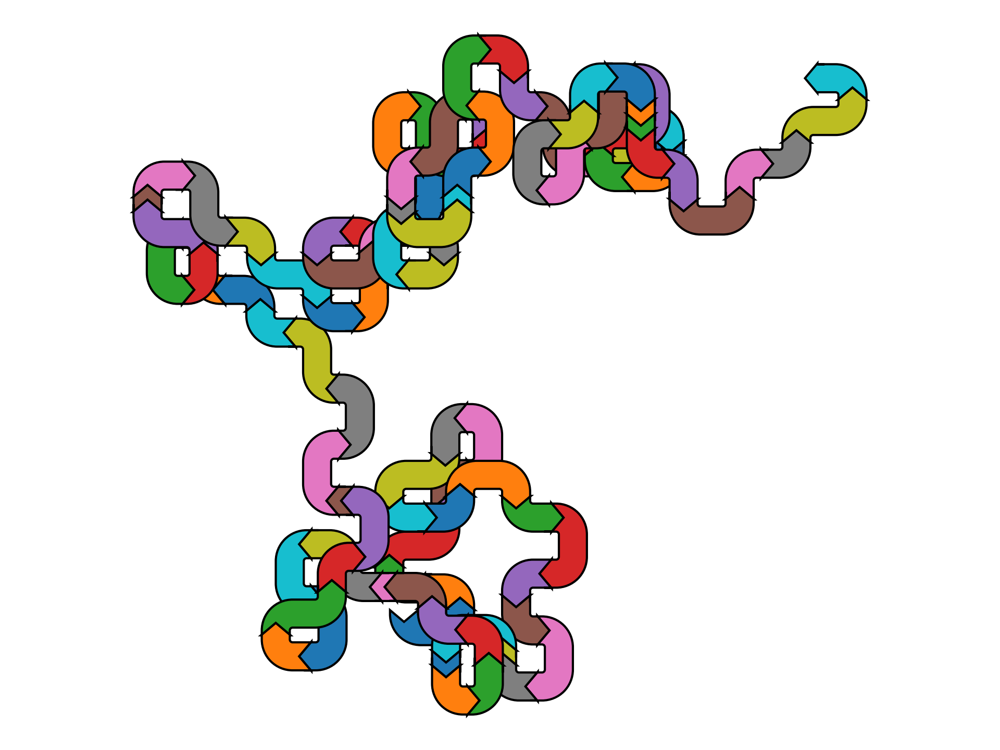

While looking into programmatically generating [Sankey diagrams](https://en.wikipedia.org/wiki/Sankey_diagram) based on the results of [discrete event simulations](https://en.wikipedia.org/wiki/Discrete-event_simulation) I made up a somewhat absurd programming exercise. Using [`matplotlib.sankey.Sankey`](https://matplotlib.org/stable/api/sankey_api.html#matplotlib.sankey.Sankey) you can draw a [random walk](https://en.wikipedia.org/wiki/Random_walk) as follows:

```python

```

Here is the plot:



It is kind of pretty in my opinion.
