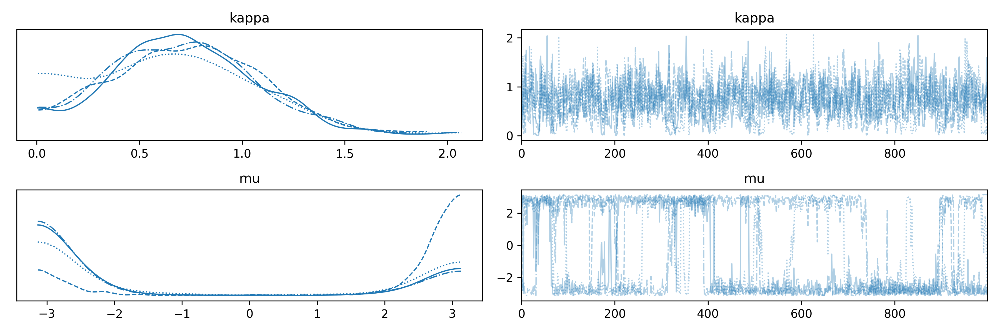

Found this code in my miscellaneous `bin` folder. Instead of deleting it I thought I would share it here. It is a minimal working example of using the PyMC package to model a Von-Mise distribution with priors put on its parameters. It is an extremely small model given by:

$$\kappa \sim \text{Exponential}(1)$$

$$\mu \sim \text{Uniform}\left( -\pi, \pi \right)$$

$$\theta \sim \text{VonMises}(\mu, \kappa)$$

And here is the aforementioned Python code:

```python

```

I can see from `observed=[-2]*10 + [2]*10` that I was tinkering with having data at exactly two angles. Maybe I was stress-testing the sampler for how it handles bimodality.

Here is *an* example output. Because I didn't set a seed number you may find your plot differs from mine somewhat.



Adding `az.summary(data, round_to=2).to_markdown('von_mise_bimdal_test.md')` to the code above we can also see a summary of the model parameters. It is not a great effective sample size (ESS) and $\hat r$, especially for $\mu$. Actually, $\kappa$ doesn't look horrible despite the low ESS. The plot above also suggests that there are a couple of states that the chain switches between, which are likely the two modes.


|       |   mean |   sd |   hdi_3% |   hdi_97% |   mcse_mean |   mcse_sd |   ess_bulk |   ess_tail |   r_hat |
|:------|-------:|-----:|---------:|----------:|------------:|----------:|-----------:|-----------:|--------:|
| kappa |   0.73 | 0.35 |     0.02 |      1.31 |        0.01 |      0.01 |     707.46 |     587.96 |    1    |
| mu    |   0.79 | 2.65 |    -3.05 |      3.14 |        0.38 |      0.27 |      76.52 |     678.25 |    1.04 |

If I were to continue developing this model I would look at having a mixture distribution for $\mu$. It would also be nice to get rid of that uniform prior on $\mu$ by replacing it with something a little more informative.
