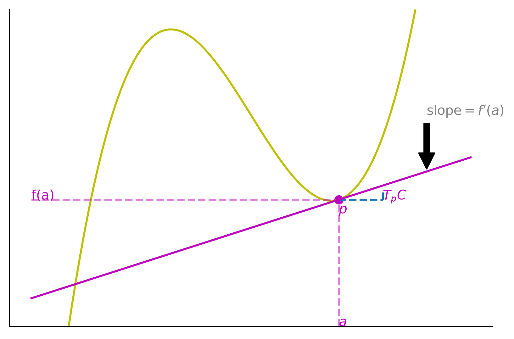
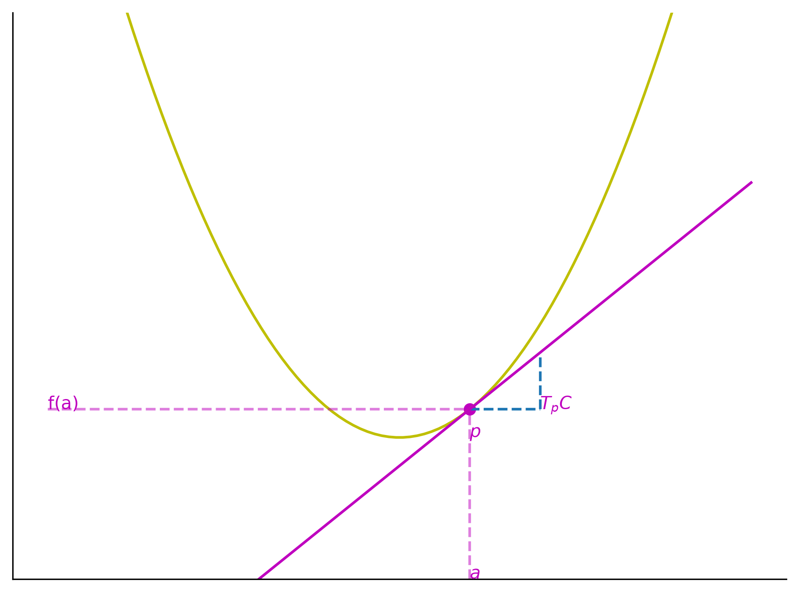
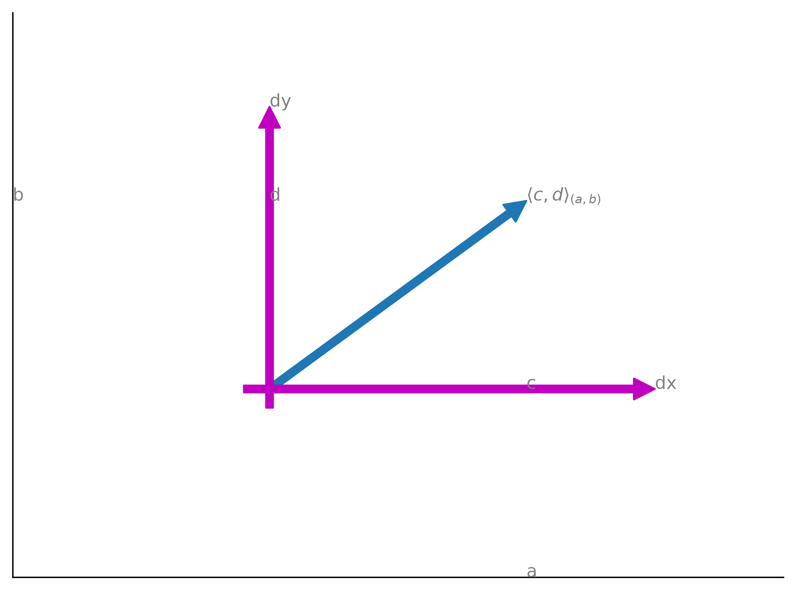

# Tangent Space 

## Definition

Suppose $C \subseteq \mathbb{R}^2$ is a curve and $p \in C$. The **tangent space to $C$ at $p$, $T_pC$** is the set of all vectors tangent to $C$ at $p$ [@flanders1989].

## Example

Let us say we have a curve $$y = f(x)$$, with a point $$p = (a, f(a))$$. A tangent vector at that point can be given by $$\vec v = \langle 1, f^{\prime}(a) \rangle$$ where $$\langle \cdot, \cdot \rangle$$ is an inner product. Then we can formulate the tangent space

$$T_pC = \text{span} \{ \langle 1, f^{\prime} \rangle \} = \{ \langle c, c f^{\prime}(a) | c \in \mathbb{R} \}.$$

```python

```



How do we differentiate between points on $C \subseteq \mathbb{R}^2$ and vectors in $T_p C \subseteq \mathbb{R}^2$?

We can create a coordinate system on $C$

$$(x,y): C \mapsto \mathbb{R}^2$$

$$(x,y)(p) = (x(p), y(p))$$

and a coordinate system on $T_p C$:

$$\langle dx, dy \rangle : T_p C \mapsto \mathbb{R}^r$$

$$\langle dx, dy \rangle = \langle dx(v), dy(v) \rangle$$

Thus $x: C \mapsto \mathbb{R}$ and $y: C \mapsto \mathbb{R}$ are combined to get a coordinate vector in the ambient space.

Similarly, $dx: T_pC \mapsto \mathbb{R}$ and $dy: T_pC \mapsto \mathbb{R}$ are combined to get a coordinate vector in the tangent space.

## Example

Let $y = x^2$, then the coordinate vector is $(x,y)(p) = (a, a^2) \in C$. Similarly $\langle dx, dy \rangle (v) = \langle 1, 2a \rangle \in T_pC$ where $v$ is a tangent vector to the function.


```python

```



> The equation $\langle dx, dy \rangle (v) = \langle 1, 2a \rangle$ implies the familiar result that $dy = 2a \cdot 1 = 2 a dx \implies \frac{dy}{dx} = 2a = f^{\prime}(a).$

## Example

Note that $$\mathbb{R}^2 = \text{span} \{ (1,0), (0,1) \} = \{ (x,y) | x,y \in \mathbb{R} \}.$$

That means that

$$T_p \mathbb{R}^2 = \text{span} \{ \langle 1, 0 \rangle, \langle 0, 1 \rangle \} = \{ \langle dx, dy \rangle | dx, dy \in \mathbb{R} \}.$$

::: {.callout-tip}
If you want to keep track of the tangent space at different points, you can denote $\langle dx, dy \rangle_p$ for the tangent space at point $p$.
:::

## Example

Suppose we have $\langle 1, 2 \rangle_{(1,1)}$, we can think of the differentials as another set of axes as visualized below.

```python

```


# 1-Forms

## Definition

A 1-form is a linear function $\omega : T_p \mathbb{R}^n \mapsto \mathbb{R}$.

## Proposition

For a 1-form $\omega : T_p \mathbb{R}^n \mapsto \mathbb{R}$ it holds that $\omega \in (T_p \mathbb{R})^{*}$ where $(T_p \mathbb{R})^{*}$ is the [dual space](https://en.wikipedia.org/wiki/Dual_space) of the tangent space $T_p \mathbb{R}$.

## Example

Given $\mathbb{R}^2$ and $T_p \mathbb{R}^2$ and  $\omega : T_p \mathbb{R}^2 \mapsto \mathbb{R}$ be linear:

$$\implies \omega (\langle dx, dy \rangle) = adx + bdx = \langle a, b \rangle \cdot \langle dx, dy \rangle$$

which also equals

$$\vert| \langle a, b \rangle \vert| \operatorname{scalar\_projection}_{\langle a,b \rangle} \langle dx, dy \rangle .$$

This leads to an intuition that a 1-form is a multiple of the scalar projection on to the same line.

## Example

Let $\omega : T_p \mathbb{R}^n \mapsto \mathbb{R}$ then

$$\omega ( \langle dx_1, \ldots, dx_n \rangle ) = \sum_{i=1}^n a_i dx_i$$

## Example

Define $\omega (\langle dx, dy \rangle) = 3dx + 2dy.$ What line does $\omega$ project vectors onto?

- The line is in the direction $\langle 3, 2 \rangle$ b/c $\omega ( \langle dx, dy \rangle ) = \langle 3,2 \rangle \cdot \langle dx, dy \rangle$

Notice that $\langle 3,2 \rangle$ is parallel to $\langle 1, \frac{2}{3} \rangle$ which entails that $dy = \frac{2}{3} x.$

## Example

Suppose $\omega$ scalar projects onto the line $dy = 2dx$ with length of 3. Find $\omega .$

We know that $\omega (\langle dx, dy \rangle) = \langle a,b \rangle \cdot \langle dx, dy \rangle .$ We need  $\langle a, b \rangle$ to be parallel to $\langle 1, 2 \rangle$ because $\langle 1, 2 \rangle$ is the vector in the direction of the line $dy = 2dx$.

So $\langle a, b \rangle = \langle a, 2a \rangle$ which requires that we have
$$\vert| \langle a, 2a \rangle \vert| = 3 $$ .

 So
$$\vert| \langle a, 2a \rangle \vert| = \sqrt{a^2 + 4 a^2} = 3 \implies a \sqrt{5} = 3 \implies a = \frac{3}{\sqrt{5}}$$ . So $b=\frac{6}{\sqrt{5}}$

$$\implies \omega (\langle dx, dy \rangle) = \frac{3}{\sqrt{5}} dx + \frac{6}{\sqrt{5}} dy$$

## Example

Supposing $n=2$ and $\omega_1 \wedge \omega_2 : T_p \mathbb{R}^2 \times T_p \mathbb{R}^2 \mapsto \mathbb{R}$ then what is $\omega_1 \wedge \omega_2 (v_1, v_2)$ where $v_1, v_2 \in \mathbb{R}^2$ ?

# References
- [Differential Forms (Michael Penn)](https://www.youtube.com/playlist?list=PL22w63XsKjqzQZtDZO_9s2HEMRJnaOTX7)
- [Differential form (Wikipedia)](https://en.wikipedia.org/wiki/Differential_form)
- [What is a differential form? (math.se)](https://math.stackexchange.com/questions/2858098/what-is-a-differential-form)
- [Differential k-form (mathworld)](https://mathworld.wolfram.com/Differentialk-Form.html)
- [Differential form (Encyclopedia of Math)](https://encyclopediaofmath.org/wiki/Differential_form)

