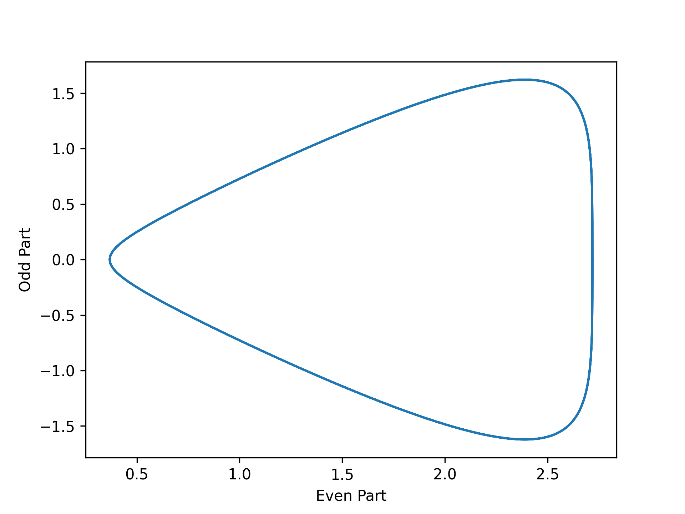

Every function is even, odd, or neither. And by "neither" I also mean a bit of both. There is a [decomposition theorem](https://en.wikipedia.org/wiki/Even_and_odd_functions#Even%E2%80%93odd_decomposition) which states that every function equipped with addition on its image can be written as the sum of an even function and an odd function. For a suitable function $f$ this can be written as:

$$f = \underbrace{f_e}_{\text{Even Function}} + \underbrace{f_o}_{\text{Odd Function}}$$

Further, when reflections of the input are defined it will also be expressible exactly as follows:

$$f_e(t) = \frac{f(t) + f(-t)}{2}$$

$$f_o(t) = \frac{f(t) - f(-t)}{2}$$

Strictly-speaking, the image of the function could be elements of a vector space, or matrices, or tensors, etc. But those are harder to visualize. Here is a snippet of code producing what I call a "parity decomposition plot of a scalar function". It plots the parametric curve of 

$$\vec p_f (t) \triangleq \begin{bmatrix} f_e(t) \\ f_o(t)  \end{bmatrix}$$

which I call the *parity decomposition vector* of a scalar function.

Let us consider the function $f(t) = \exp \left(\cos t + \sin t \right)$ as an example. The decompositions are as follows:

$$f_e(t) = \frac{\exp \left(\cos t + \sin t \right) + \exp \left(\cos (-t) + \sin (-t) \right)}{2}$$

$$f_o(t) = \frac{\exp \left(\cos t + \sin t \right) - \exp \left(\cos (-t) + \sin (-t) \right)}{2}$$

$$\vec p_f (t) \triangleq \begin{bmatrix} \frac{\exp \left(\cos t + \sin t \right) + \exp \left(\cos (-t) + \sin (-t) \right)}{2} \\ \frac{\exp \left(\cos t + \sin t \right) - \exp \left(\cos (-t) + \sin (-t) \right)}{2}  \end{bmatrix}$$

Here is the decomposition using Python (NumPy):

```python

```



I've wondered if parity decomposition could be useful in further understanding machine learning models, but things get complicated. Often machine learning models map many inputs to many outputs. 

For the inputs there are the various combinations of signatures that could be reflected, although the nicest first approximation is to reflect all of them. But one must still choose what set of points to consider. A natural choice is the data itself. Other choices may involve choosing parametric curves, surfaces, or general manifolds.

For multiple outputs we are left with a decomposition vector for each output, which can be formatted into an array of some compatible shape. Most multivariable plots would become rather messy, with too many things overlapping. One option is to plot the parity decomposition plot for each output, producing a collection of plots of size equal to the number of scalar outputs of the ML model. Another option might be dimensionality reduction techniques such as [principal components analysis](https://en.wikipedia.org/wiki/Principal_component_analysis) or manifold-based methods as provided in scikit-learn.
