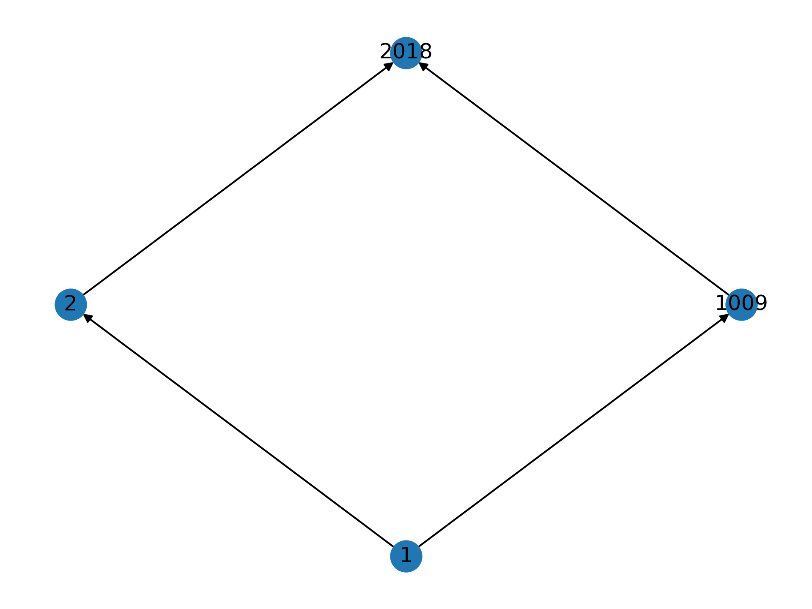

Disappointed by ChatGPT in [*Asking ChatGPT to Code a Plotting Function for Covering Diagrams*](https://galenseilis.github.io/posts/chatgpt-plot-covering-diagram/) but inspired by some of the diagrams in [*The Joy of Abstraction: An Exploration of Math, Category Theory, and Life*](https://www.goodreads.com/en/book/show/60658614) by Eugenia Cheng, I decided to take a quick attempt at plotting [Hasse diagrams](https://en.wikipedia.org/wiki/Hasse_diagram) for the factorization of positive integers.

```python

```

For the choice of integer `2018` given above we get the following diagram.


