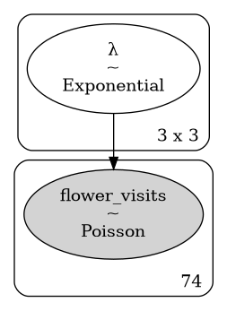
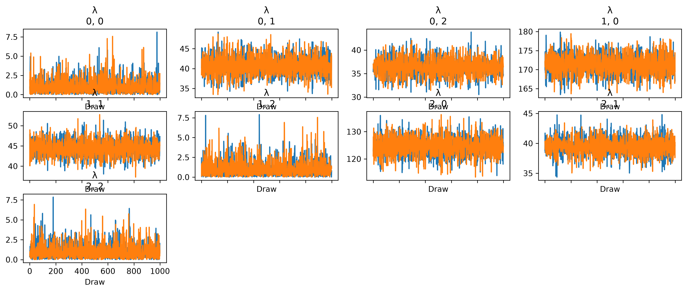

## Introduction

This post produces a model of flower visits as described in @651343. Here is the author's description of the data:

> My data consists of 3 variables, one is a numerical variable of the number of flower visits that I have counted on certain locations and on certain shrub species. My other 2 variables are categorical variables: Category ID (location), which can be either "RA", "RN" or "UN" and Species, which can be either "Common hawthorn", "Blackberry" or "Rose".

## Getting the Data

The first problem we have to solve is obtaining the data. This can be done with the `requests` Python library.

```python

```

## Parsing the Data

Just because we have successfully obtaining code from the target URL does not mean it is in a form for analysis. The next steps involve parsing the site response text using Beautiful Soup, a Python package dedicated to this very task. It will look through the HTML to identify the desired block of code which contains the example data, which I identified by looking for the substring `"visits_df"`. 

```python

```

```python

```

| Category_ID | Species | Total_visits |
|:---|:---|---:|
| UN | Common hawthorn | 22 |
| UN | Common hawthorn | 42 |
| UN | Common hawthorn | 3 |
| UN | Common hawthorn | 13 |
| UN | Common hawthorn | 76 |
| UN | Common hawthorn | 95 |
| UN | Common hawthorn | 53 |
| RN | Common hawthorn | 50 |
| RN | Common hawthorn | 18 |
| UN | Common hawthorn | 6 |
| UN | Common hawthorn | 16 |
| RA | Common hawthorn | 48 |
| RA | Common hawthorn | 63 |
| RA | Common hawthorn | 35 |
| RA | Common hawthorn | 40 |
| RN | Common hawthorn | 49 |
| RA | Common hawthorn | 25 |
| RA | Common hawthorn | 73 |
| RN | Common hawthorn | 107 |
| UN | Common hawthorn | 62 |
| UN | Common hawthorn | 60 |
| RN | Common hawthorn | 66 |
| RN | Common hawthorn | 29 |
| RN | Common hawthorn | 33 |
| RN | Common hawthorn | 79 |
| UN | Common hawthorn | 19 |
| UN | Common hawthorn | 16 |
| UN | Common hawthorn | 35 |
| UN | Common hawthorn | 43 |
| RN | Common hawthorn | 30 |
| RN | Common hawthorn | 27 |
| UN | Common hawthorn | 94 |
| UN | Common hawthorn | 54 |
| RN | Blackberry | 126 |
| RN | Blackberry | 145 |
| RN | Blackberry | 145 |
| UN | Blackberry | 93 |
| UN | Blackberry | 173 |
| RA | Rose | 17 |
| RA | Rose | 26 |
| RA | Rose | 44 |
| RA | Rose | 9 |
| RA | Rose | 18 |
| UN | Blackberry | 144 |
| RN | Blackberry | 129 |
| RN | Blackberry | 168 |
| RN | Blackberry | 334 |
| RN | Blackberry | 342 |
| RN | Blackberry | 306 |
| RN | Blackberry | 283 |
| UN | Blackberry | 308 |
| RN | Blackberry | 266 |
| RN | Blackberry | 244 |
| RA | Rose | 44 |
| RA | Rose | 36 |
| RA | Rose | 62 |
| RA | Rose | 85 |
| UN | Blackberry | 106 |
| RN | Blackberry | 123 |
| RN | Blackberry | 153 |
| RN | Blackberry | 198 |
| UN | Blackberry | 181 |
| RA | Rose | 58 |
| UN | Blackberry | 64 |
| RN | Blackberry | 150 |
| RN | Blackberry | 85 |
| RN | Blackberry | 114 |
| RN | Blackberry | 137 |
| UN | Blackberry | 84 |
| RN | Blackberry | 121 |
| RN | Blackberry | 148 |
| RN | Blackberry | 104 |
| RN | Blackberry | 117 |
| UN | Blackberry | 93 |

```python

```

```default
                            Total_visits              ...
                                   count        mean  ...     75%    max
Category_ID Species                                   ...
RA          Common hawthorn          6.0   47.333333  ...   59.25   73.0
            Rose                    10.0   39.900000  ...   54.50   85.0
RN          Blackberry              22.0  179.000000  ...  232.50  342.0
            Common hawthorn         10.0   48.800000  ...   62.00  107.0
UN          Blackberry               9.0  138.444444  ...  173.00  308.0
            Common hawthorn         17.0   41.705882  ...   60.00   95.0

[6 rows x 8 columns]
```

## Model Definition

Now that we have the data loaded, let's define the basic model.


```python

```

Here is the model diagram:

```python

```



## Model Fitting

```python

```

## Model Evaluation

```python

```

```python

```


