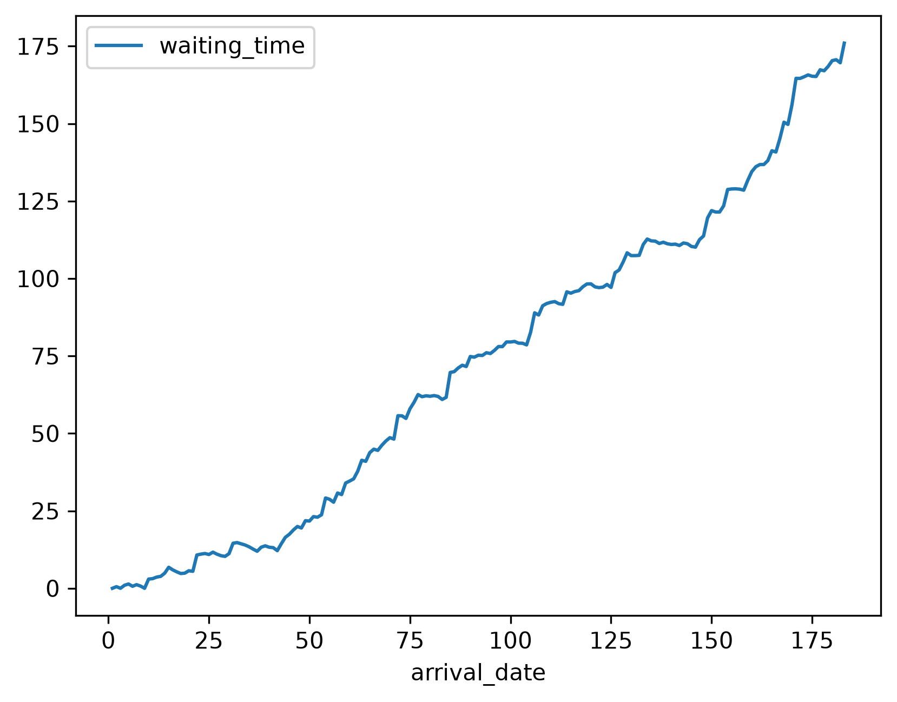
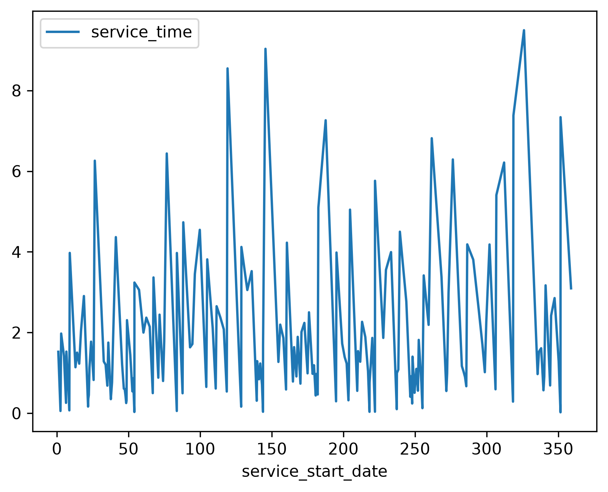
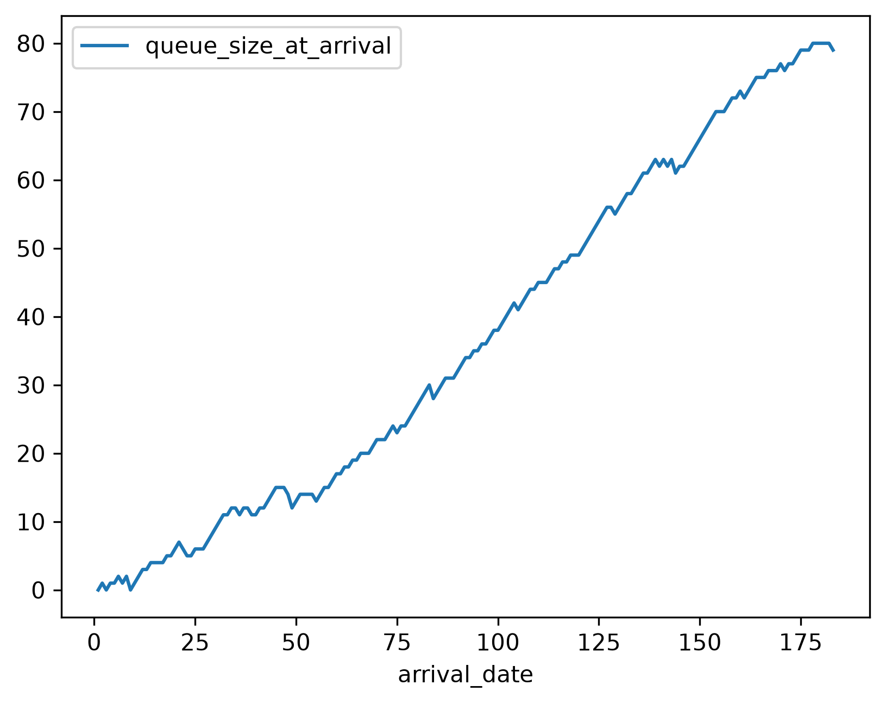
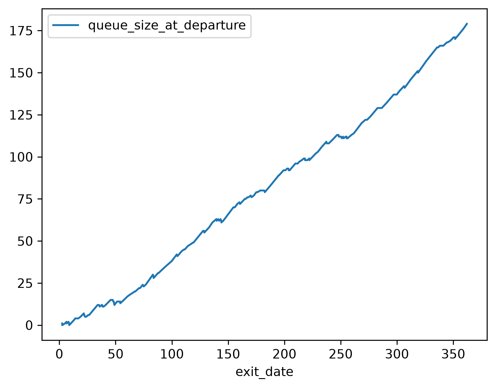

## Introduction

[Ciw](https://ciw.readthedocs.io/en/latest/) is a [Python](https://www.python.org/) package for [simulating](https://en.wikipedia.org/wiki/Discrete-event_simulation) [queueing networks](https://en.wikipedia.org/wiki/Queueing_theory). 

## Simulation

A [D/M/1 queue](https://en.wikipedia.org/wiki/D/M/1_queue) can be implemented and simulated using Ciw in the following way.

```python

```

## Results

We can tabulate the results.

```python

```

```default
|        |   waiting_time |   service_time |   queue_size_at_arrival |   queue_size_at_departure |
|:-------|---------------:|---------------:|------------------------:|--------------------------:|
| count  |            183 |            183 |                     183 |                       183 |
| mean   |        71.9111 |        1.96964 |                 36.8087 |                   73.3607 |
| std    |         51.243 |         1.8815 |                 25.7219 |                   51.6083 |
| min    |              0 |      0.0229044 |                       0 |                         0 |
| 25%    |        19.1338 |       0.676208 |                    13.5 |                        20 |
| 50%    |        75.1552 |        1.28472 |                      34 |                        76 |
| 75%    |        111.045 |        2.53828 |                      61 |                       112 |
| max    |        175.985 |        9.49261 |                      80 |                       179 |
```

We can plot the arrival times against the waiting times.

```python

```



We can plot the service start times against the service times.

```python

```



We can plot the arrival dates against the length of the queue when the customer arrived.

```python

```



We can plot the departure dates against the length of the queue when the customer departed.

```python

```


