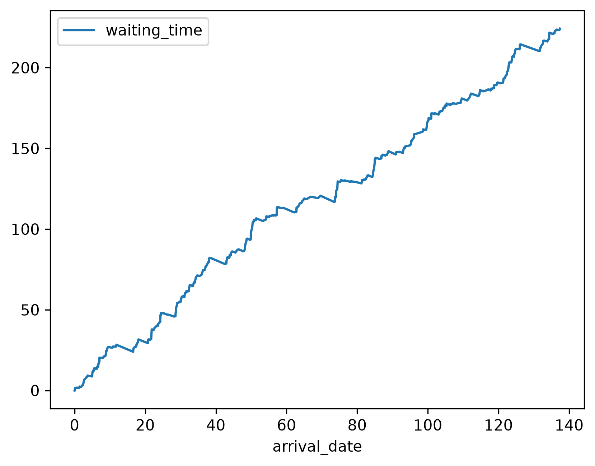
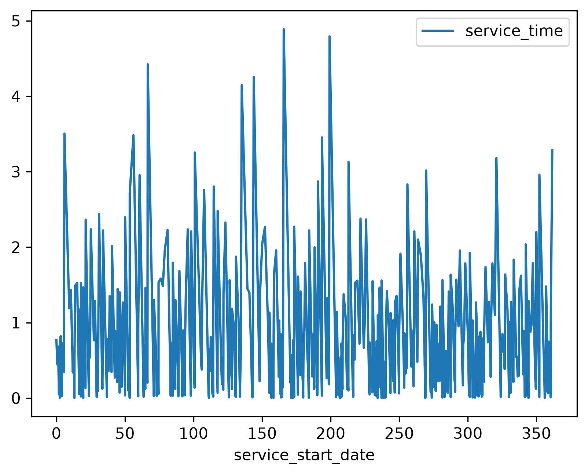
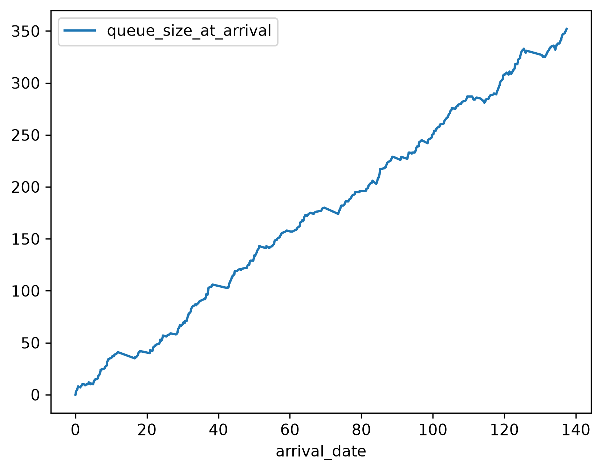
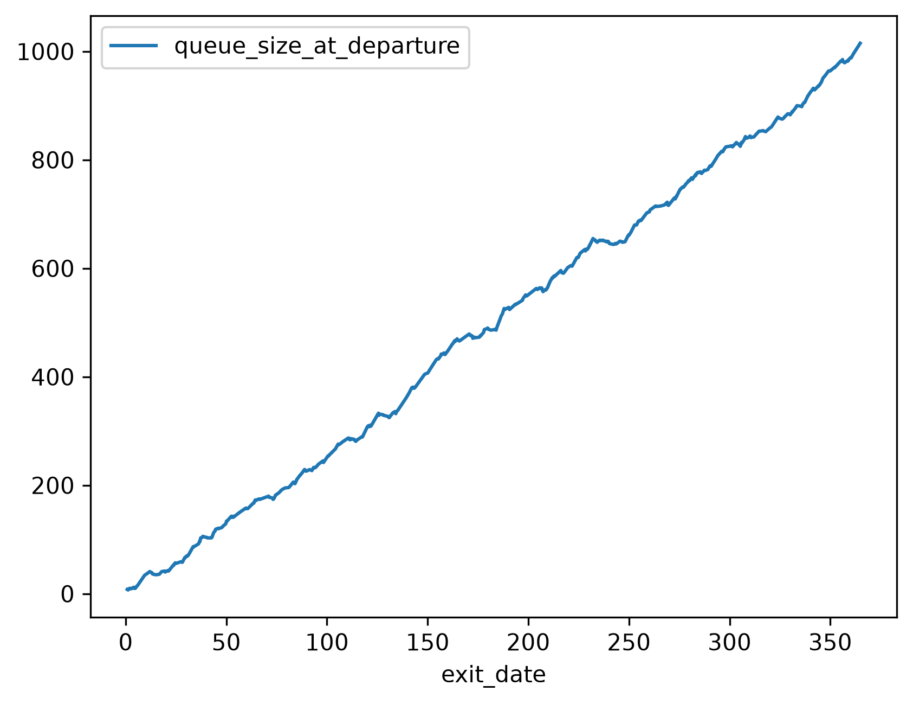

## Introduction

[Ciw](https://ciw.readthedocs.io/en/latest/) is a [Python](https://www.python.org/) package for [simulating](https://en.wikipedia.org/wiki/Discrete-event_simulation) [queueing networks](https://en.wikipedia.org/wiki/Queueing_theory). 

The two G's in G/G/1 do not have to be the same distribution, and respectively can be any distribution with non-negative support.

We will use a [Hyperexponential distribution](https://en.wikipedia.org/wiki/Hyperexponential_distribution) for the arrival distribution. A hyperexponential distribution is exactly a [mixture distribution](https://en.wikipedia.org/wiki/Mixture_distribution) of [exponential distributions](https://en.wikipedia.org/wiki/Exponential_distribution). This has an interpretation of there being an implicit set of arrival processes that each have their own distinct but independent exponential arrival times. In this case we will choose a mixture of four such arrival processes with distinct arrival rates:

$$\begin{align} U_1 \sim & \text{Exponential}\left( \frac{1}{9} \right) \\ U_2 \sim & \text{Exponential}\left( \frac{1}{5} \right) \\ U_3 \sim & \text{Exponential}\left( \frac{1}{6} \right) \\ U_4 \sim & \text{Exponential}\left( 1 \right) \end{align}$$

The following mixture distribution for the arrival times will be used:

$$T_{\text{arrivals}} \sim \frac{1}{5} f_{U_1} + \frac{1}{10} f_{U_2} + \frac{3}{5} f_{U_3} + \frac{1}{10} f_{U_4}$$

We will use a [gamma distribution](https://en.wikipedia.org/wiki/Gamma_distribution) for the sake of example. A gamma distribution is the result of a sum of [independent](https://en.wikipedia.org/wiki/Independence_(probability_theory)) [exponentially-distributed](https://en.wikipedia.org/wiki/Exponential_distribution) [random variables](https://en.wikipedia.org/wiki/Random_variable), and thus for this example we have an interpretation that the servicing is implicitly a multi-step process where each step has an exponentially-distributed completion time. 

## Simulation

A [G/G/1 queue](https://en.wikipedia.org/wiki/G/G/1_queue) as described can be implemented and simulated using Ciw [@kendall1953] in the following way.

```python

```

## Results

We can tabulate the results.

```python

```

```default
|        |   waiting_time |   service_time |   queue_size_at_arrival |   queue_size_at_departure |
|:-------|---------------:|---------------:|------------------------:|--------------------------:|
| count  |            546 |            546 |                     546 |                       546 |
| mean   |        118.578 |       0.668262 |                 176.855 |                   510.295 |
| std    |        64.0327 |       0.813994 |                 103.554 |                   289.318 |
| min    |              0 |    9.40731e-07 |                       0 |                         7 |
| 25%    |        66.9117 |      0.0991315 |                      87 |                       258 |
| 50%    |        119.865 |       0.348732 |                   177.5 |                     527.5 |
| 75%    |        175.243 |       0.901602 |                  270.75 |                     763.5 |
| max    |         224.18 |        4.88812 |                     352 |                      1015 |
```

We can plot the arrival times against the waiting times.

```python

```



We can plot the service start times against the service times.

```python

```



We can plot the arrival dates against the length of the queue when the customer arrived.

```python

```



We can plot the departure dates against the length of the queue when the customer departed.

```python

```



