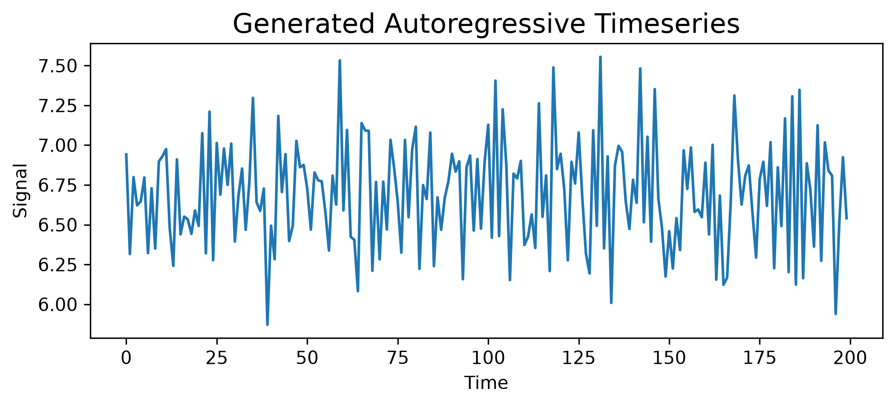

In this post I will show you how to simulate an [autoregressive (AR) process](https://en.wikipedia.org/wiki/Autoregressive_model) using Matplotlib and NumPy.

First, let's define a function which pseudorandomly generates the data sequence. We'll set an intercept parameter to set a consistent offset of the series from zero, and a sequence of autoregressive coefficients. The order of the coefficients entails the lag order that they are each applied to, so if you want to skip a lag order you can just set it to zero. Some AR series are noisier than others, and you can set that level of noise using the `noise` parameter. In this model we assume that the noise is a [stationary](https://en.wikipedia.org/wiki/Stationary_process) normal distribution:

$$\epsilon_t \sim \mathcal{N}(0,\sigma)$$

for all $t$.

The following implementation is a generalization of the implementation provided in  [*Generate Fake Autoregressive Data*](https://www.pymc.io/projects/examples/en/latest/time_series/Forecasting_with_structural_timeseries.html#generate-fake-autoregressive-data) in which I have allowed for any number of time lags. I have also allowed a user-provided random number generator to be passed.

```python

```


Let us set a seed for reproducibility.


```python

```

Now let's choose some parameters.

```python

```

Now let us simulate the AR process.

```python

```

Finally, let us plot the simulated data using Matplotlib.

```python

```



This implementation is not particularly efficient in terms of computing resources. Although performance is influenced by many things, a large factor is the presence of an ordinary `for` loop. Upon every iteration of the loop the Python interpreter will check that all types are still valid, which is a waste of computing resources when you can assume that they are. Perhaps I will write a more efficient function, but this example should be suitable for examples and tinkering for now.


---

Here is the output data for the example:

```python

```

```default
[6.941708   6.3155875  6.79896769 6.62115125 6.64690478 6.79654732
 6.32163015 6.72852581 6.35004628 6.89721308 6.92979629 6.97466588
 6.47919687 6.24134393 6.91045418 6.43927381 6.55083547 6.53331397
 6.44255904 6.58915744 6.4923775  7.07488836 6.32039603 7.21035304
 6.27709664 7.0134047  6.68872494 6.97816857 6.75025929 7.00950853
 6.39465926 6.68118717 6.85268958 6.46779684 6.76181945 7.29674199
 6.64142503 6.58699206 6.72707155 5.87192126 6.49363922 6.28287734
 7.18342675 6.70507765 6.94382677 6.39717353 6.49306093 7.02621907
 6.8610425  6.87523356 6.7267247  6.46888024 6.8280871  6.7789368
 6.77176061 6.58257732 6.33784174 6.808397   6.62658717 7.53212642
 6.59001865 7.09541224 6.4240351  6.40443905 6.08217251 7.13828813
 7.09221513 7.08928927 6.21026942 6.76872715 6.28272682 6.77029136
 6.46984318 7.0331383  6.85807573 6.64286023 6.3238929  7.03278515
 6.54674528 6.97528036 7.11517396 6.22263056 6.74882539 6.66139963
 7.0783666  6.23980551 6.67212967 6.46792713 6.66990209 6.77251836
 6.94614928 6.83357381 6.89816709 6.15734245 6.86025094 6.93488203
 6.46304183 6.91241082 6.47560317 6.89390062 7.12772216 6.41811335
 7.40498293 6.42844055 7.2251552  6.87492573 6.15158164 6.82079686
 6.790811   6.90070107 6.37238571 6.42500936 6.56438666 6.35378324
 7.26239073 6.54888149 6.80957892 6.20860224 7.48779131 6.84955546
 6.94570356 6.72697226 6.27613628 6.89544594 6.75888508 7.07931692
 6.66666166 6.3180758  6.19398727 7.09355878 6.49304741 7.55478488
 6.35099042 6.92931065 6.00868397 6.86902339 6.99545602 6.95783505
 6.64467603 6.47337945 6.78201172 6.63753378 7.48158873 6.51522663
 7.05250727 6.39296225 7.3519113  6.66425586 6.48041592 6.17408598
 6.45883478 6.22486773 6.54137246 6.34066406 6.96759892 6.72473722
 6.98529234 6.58060658 6.59542768 6.54721287 6.88949907 6.43898143
 7.00231541 6.1544984  6.68328599 6.12233025 6.16702292 6.64338878
 7.31158216 6.90580583 6.62631565 6.80756359 6.87177271 6.57651991
 6.29329644 6.78533065 6.8948178  6.61792592 7.0182514  6.22628874
 6.86051622 6.49121734 7.16799008 6.20211378 7.30671013 6.12323977
 7.34758837 6.16358606 6.88596075 6.71944393 6.36211338 7.12466492
 6.27294854 7.01723785 6.84008439 6.80771285 5.93900768 6.51765076
 6.92400731 6.54072599]
```
