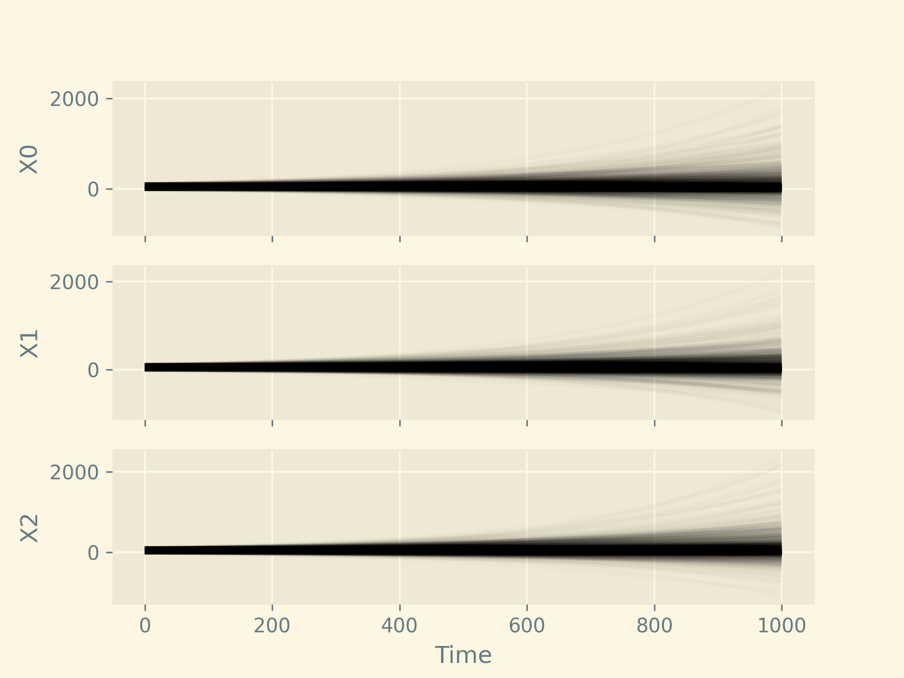

Random differential equations result when some combination of parameters in the rate equations or the initial (or boundary) conditions are random variables. Combining the world of differential equations with the world of mathematical statistics allows us to hypothesize about how a system works well, accommodating uncertainty into our analysis. See [Strand 1970](https://core.ac.uk/download/pdf/82447522.pdf) for an introduction to random differential equations.

In this post we'll consider the linear system:

$$\vec Y(0) \sim \mathcal{U}(-10, 110)$$

$$\mathbf{A}_{ij} \sim \mathcal{U}(-1, 1)$$

$$\frac{dY(t)}{dt} = \mathbf{A} \vec Y(t)$$

::: {.callout-warning}
[Random differential equations are not the same as stochastic differential equations](https://math.stackexchange.com/questions/72208/whats-the-difference-between-rde-and-sde). The latter allows for added variation from a (not necessarily stationary) stochastic process which require techniques such as [Itô integrals](https://en.wikipedia.org/wiki/It%C3%B4_calculus) or [Stratonovich integrals](https://en.wikipedia.org/wiki/Stratonovich_integral).
:::
The code to compute this system is given below, using SciPy [@virtanen2020]:

```python

```

Here is the resulting plot. Since we chose the coefficient distributions somewhat haphazardly, it should not be surprising that no particular direction was preferred for this system.


